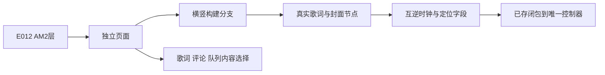

# Sollin AM2 页面和内容切换证据

2026-10-17，普通移动逆向，flavor=null。E-016补充AM2独立页面、横竖布局、内容选择及歌词定位关系；只形成下一批实施依据，本批没有新增第八布局或参考运行结果。

## 范围与复现

reverse-skill固定`cab634bd855fc287f6e420c1f36fd1a6b9245960`。macOS原生master-route输出`work/master-route-20261017-233813/route-scope.md`，PRIMARY mobile-reverse；沿现有授权离线scope，case-guard、工具索引及项目门禁通过，没有重建/覆盖已有scope。IPA SHA256 `c2ee2deba236ef1b9e097e1d8cdc0b816137aa57cf85d4c8e2811dae9924bc07`；成员App.framework/App SHA256 `640c6112584c017b45141a038f7aa975224c8b540ef1aaec1f40939a6aa5c84d`。表内为arm64 slice VA，__TEXT内VA等于slice偏移，FAT raw另加0x4000。

索引Python3.12.14/cstool5.0.3执行限定解码；Blutter0039efb1/Dart3.12.2 no-analysis骨架仅用于地址/类归属，decoded objectpool用于枚举和闭包身份，不能代替原始BL。`notes/am2-probe.py`产生有界输出，`notes/am2-evidence.py`逐条验证原始BL、分配头和解码字节；不可变收据拒绝覆盖，重放需新输出名。收据创建前断言曾拒绝错误pool文本格式，亲读实际`Double:0/1`后修正匹配；未跳过检查。探查旧文件名`am2-progressSeek.txt`不构成语义，实际调用已确认为音量。

`source scripts/environment.sh`后，先执行`node scripts/sollin-reverse-gate.mjs ipa`，补齐工作项与timeline后执行同命令加`--review`。最终16E/15F/15P、7工作项/25事件，零错误/警告。原始输出、样本、objectpool及脚本仅留本机忽略目录。

## Evidence→Finding→Path

E-016 `evidence/am2-evidence.json` SHA256 `b17c3dd201b3891651f9c2b43bc6d8e0a0f9c6c7b67ea210d8e0d09842f83cf9`，观察时间23:42:58。F-015为info/design、candidate/high；P-015从E012 AM2宿主分派进入独立页面，沿布局、内容和定位回调约束原创实施。

| 原始位置 | 确认内容与边界 |
| --- | --- |
| 0x521e14→0x52208c | 分配头类4544，骨架归属AppleMusic2PlayerPage；延续E012的AM2层，不能拿既有AM改名替代 |
| 0x5f42ac–2d0 | 约束两个浮点字段比较并分支，分别直接调用竖向0x5f7df0、横向0x5f443c；字段语义沿BoxConstraints归属，不据此恢复全部尺寸 |
| 0x5f8424/0x5f4918→0x5f5194；0x5f9688/0x5f4518→0x5f7bf8 | 两布局分别分配真实LyricPlayerView4545和Cover4130；不意味着其排版/特效已完整恢复 |
| 0x5f5c98、0x5f61ec、0x5f625c→0x5f5cb4 | 三入口共享内容切换，pool枚举对应队列2/评论1/歌词0；dispatcher可关闭当前项或切换新项 |
| 0x5f7dc8–dd0、0x5f7cb0–cc4 | 时钟加widget字段df；点击定位减同字段、下限0、转Duration。字段完整业务来源/符号策略不据此强行改写音枢 |
| 0x521fb0–fc8、0x5f7ce0–cf8；0x5257ac→0x138da8 | 页面字段11f存入pool4e238闭包525728，点击间接调用同字段，闭包直接调用controller.seek；间接边与直接BL分别记录 |
| 0x522868→0x522884 | 另一双精度回调实际setDisplayVolume，不能当作seek |
| 0x521910–918、0x521710–79c | 展开值减归一化拖动量，归一化速度×1000与pool420比较，低速回落以0.5选端点；完整控制命中排除、几何与运行效果仍待 |

图是静态职责图，不表示参考App已启动。报告采用docs-generator与diagram-generator的可编辑源码图流程，不上传样本、原始输出或社区内容。

## 后续实施与验收边界

AM2需要真正独立于现有AM的封面/内容布局和横向结构；下一批先核完整控制命中排除、默认设置和自动全屏，避免整面拖动截获进度、音量、歌词或队列。新布局复用音枢唯一队列/意图、实际录音封面歌词、原曲收藏/评论归属及现有正值延后偏移，不复制参考商业门槛、账号服务或绘制源码。

按[参考比较](REFERENCE_COMPARISON.md)逐项检查五项目后再实现；初步职责比较见下。需要业务边界测试、实际App切换/暂停/定位/音量/重启、大字及iPad横竖/窗口验收，之后清洁本地IPA和对应云端iOS27。完整cover-flight、自动全屏、特效与手机性能不能由“有第八选项”替代。

| 固定参考 | 本批亲读/可参考职责 | 维护、Android、许可与取舍 |
| --- | --- | --- |
| 悦音 d6f1af7 | LyricsView.tsx:154容器高度/行焦点和seek回调 | Expo54职责参考；根MIT及资产边界沿原记录，不移植列表动画或原生依赖 |
| Q 547ccfe | PlayDetail/Horizontal/index.tsx:55封面/控制与歌词左右分栏；Vertical/index.tsx:16按首次可见挂载 | RN0.73及pager/native模块不引入；Apache2/逐文件边界，Android与iOS窗口分别验 |
| wtf 6624ab5 | PlayDetail/Vertical/index.tsx:80明确pager子页flex，防止iOS高度塌缩 | 不搬旧导航、pager或播放后端；Apache2/逐文件边界，需本项目窗口测试 |
| Cy bf0d469 | components/lyric/index.tsx:40状态管理器与当前行、拖动/自动滚动职责 | 不引入Expo57/RNTP/gesture-handler；Apache2与RNTP独立许可，Android原生绘制另验 |
| 自有Wayferar 8e47cdc | importer/StageLyricLayout.java:17按可用宽度与Unicode边界测量 | 未找到可直接当AM2的对应证明；Java参考/Smali权威及第三方边界保留，不搬Android Paint/View实现 |

以上仅采纳职责和验收经验，无源码复制、依赖或原生补丁引入。全部A/F/J、平台登录推荐/FM及最后下载顺序继续；当前音枢仍为七种实际布局。

## E-017 控件指针与自动全屏声明补证

后续同一离线scope补证E-017→F-016→P-016，收据`evidence/am2-input-evidence.json` SHA256 `c43d752df84dc9f10abe6e8666531664721f09021c48880a6e61a2cabdfe26b8`，观察23:48:51。脚本`notes/am2-input-probe.py`/`am2-input-evidence.py`逐条原字节验证；首轮收据前call-PC断言发现偏移4字节，修正到实际BL并重验，没有绕过断言。

- 控件包装0x5f9a40–a60加载标记闭包；标记0x5f513c–178读state127并传递事件ID。松手0x5fa834–8e8读同字段，经helper返回值、移动和全屏状态分支决定是否执行页面动作；move0x5fabe4有距离18门槛，cancel0x5fa744–74c清field137。SDK helper具体实现和所有多指行为仍待，不能只看函数名宣称完整手势恢复。
- 默认对象pool4db38，经toJson0x495eb0–ee8键/字段对应，声明`showVolumeControl=false`、`autoFullscreenLyrics=true`、`autoFullscreenLyricsDelaySeconds=5`。notifier0x4970e8–f0与fromJson0x497cdc–cec引用同对象；不等于用户持久化后的有效状态已动态验证。
- schedule0x5f5dfc–e9c检查page37/2f和widget7f、处理旧handleaf，用widget87×1000000构造延迟、加载闭包5f5ee0并写新handle；callback0x5f5f3c–40重查开关/状态。具体SDK定时器内部实现、生命周期与动画运行尚未恢复。
- pool58120首个归属标记为QQ绑定，但原始闭包4faa00–a14只给捕获状态field3f写false。共享通用闭包不能推导AM2调用QQ服务；采纳的是原始操作，不采纳该归属名称的业务含义。

E-017补齐后严格review通过17E/16F/16P、7工作项/26事件、零错误/警告。实施前需要保留独立控件命中区域、自动功能显式设置、切歌/关页/后台/内容切换后的迟到回调守卫；实际AM2开发和验收继续，七布局状态不变。
