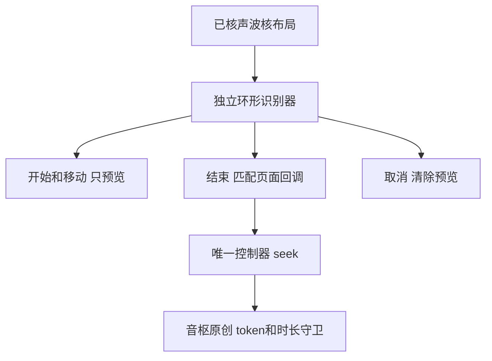

# Sollin 渲染分派及声波核环形定位报告

2026-10-17，普通移动逆向，flavor=null。本批从已核宿主继续独立解码限定ARM64方法，确认沉浸布局四个分支和声波核预览/提交/取消职责。舞台不是声波核改名，调用到独立LyricStagePage。音枢先补齐已有声波核的真实定位交互；完整视觉/特效、AM2/舞台与动态运行仍待。未访问参考服务、安装目标、签名或注入。

## 范围与工具

授权和离线范围沿本机`work/sollin-ipa/scope.md`，auth=granted、network=offline。reverse-skill固定`cab634bd855fc287f6e420c1f36fd1a6b9245960`，本批原生master-route为`work/master-route-20261017-223355/route-scope.md`、PRIMARY mobile-reverse；case-guard/项目门禁通过。索引Python3.12.14、cstool/Capstone5.0.3；首次Python capstone binding导入缺失，未安装新工具，改用索引中现有cstool。Blutter0039efb1/Dart3.12.2的NO_CODE_ANALYSIS骨架仅用于函数/类所有权，不称完整反编译。

固定IPA SHA256 `c2ee2deba236ef1b9e097e1d8cdc0b816137aa57cf85d4c8e2811dae9924bc07`；成员App.framework/App SHA256 `640c6112584c017b45141a038f7aa975224c8b540ef1aaec1f40939a6aa5c84d`。下列为arm64 slice VA，__TEXT内VA=file offset，FAT raw另加0x4000。原始指令/对象池/样本保留本机忽略目录。

## Evidence→Finding→Path

| ID | 内容 | 边界 |
| --- | --- | --- |
| E-013 | `evidence/renderer-evidence.json`，SHA256 `9c222fdfff7458e1b3d77ba6cc583e58f74cc69ab5d603e97e1e6c1c0d5f6500`，含限定BL/池引用/字段/分配头及文件摘要 | 固定原始字节，不是参考运行证据 |
| F-012 | candidate/high/design；沉浸布局分派及环形预览、提交、取消 | 只恢复列出的关系，尺寸/完整效果待核 |
| P-012 | host声波核→layout1→ring识别器→预览/提交/取消→原控制器seek→音枢原创交互 | 无商业门槛/参考服务或第二播放器 |

采纳前strict review：13E/12F/12P、7工作项/20事件，零错误/警告；WI-003、timeline与本机field-journal更新。

## 限定渲染分支

E-012已核参考标签索引4–7传入ImmersivePlayerLayout0–3；本批layout closure0x67b918比较该布局对象字段并调用：

| 布局 | 原始调用点→目标 | 已核含义 |
| --- | --- | --- |
| 0 封面沉浸 | 0x67ba20→0x67f344 | `_buildFullCover` |
| 1 声波核 | 0x67ba38→0x67d024 | `_buildWaveCore` |
| 2 写真歌词 | 0x67ba58→0x67ba84 | `_buildPosterLyrics` |
| 3 歌词舞台 | 0x67b9a4/0x67ba68→0x681fbc | `_buildLyricStage`，0x6820ec分配class4528/LyricStagePage |

舞台分支优先于随后横屏分派；其他布局的横屏另走0x6810bc/0x6805fc，不外推所有方向完全相同。fullCover/wave/poster内部已见不同子控件分配，但完整组件字段、样式与屏幕结果不由本表证明。

## 声波核交互关系

0x59c574→0x59c61c分配头核对class3636 `_RingSeekRecognizer`。0x59c538的成对ADD/LDR引用pp0x5de38/40/48/50/58并分别存入识别器回调字段，绑定canGrab/begin/update/end/abort。begin0x2bf000和update0x59cc44直接调用页面preview0x2bf0b0；end0x59c804→commit0x59c858，abort0x59c6ac→cancel0x59c700。

commit在0x59c90c进行duration与fraction乘法，再经0x59c990读取页面field_b8（tagged位移0xb7），0x59c9a4以BLR调用。页面构建0x523478/0x52347c读取pp0x4d4e0的闭包0x52433c，并在0x52348c存入相同field_b8；该闭包0x5243c0直接BL到MusicPlayerController.seek0x138da8。这里是匹配字段/闭包数据流，**不是**commit直接BL到seek。原始canGrab含中心距离计算，不能据此照搬音枢尺寸/触摸区域。商业激活/特效选择明确排除。

## 采纳和验证

五参考实现、维护、Android/许可逐项比较及音枢原创方案见[0041](decisions/0041-wave-ring-seek.md)。无参考源码/依赖/资源复制。音枢保持真实PCM频谱、暂停/播放意图、原曲收藏/匹配录音、队列/歌词与独有黑胶。335项业务/类型检查通过；正式App `SourceUITests-1792248125950.xcresult` 综合回归198.360秒、1/1通过且零失败/跳过，暂停/播放拖环、同源进度、中心按钮/真实PCM及旧多皮肤/歌词/mini/重启/凭据清理通过，亲看最终截图。App多指/后台/VoiceOver/拖中切歌未逐项注入验收。清洁unsigned归档/正常push/云端iOS27按[BUILD_STATUS](BUILD_STATUS.md)真实记录，未预填成功。

复现：`source scripts/environment.sh`后运行`node scripts/sollin-reverse-gate.mjs ipa`；索引Python执行案例`notes/renderer-probe.py`，再`notes/renderer-evidence.py`，不可变收据重放需使用新文件名；更新WI/timeline后运行`node scripts/sollin-reverse-gate.mjs ipa --review`。脚本检查原始摘要和限定指令，不需网络/新工具。后续继续AM2/舞台渲染/动态几何、其余A03/A06–09及全部F/J；真实服务、签名、真机和性能分别验收。未向社区发送内容。
