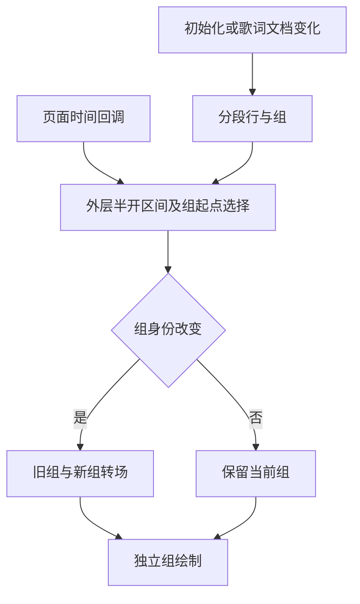

# Sollin 歌词舞台分段与时间轴报告

2026-10-17，普通移动逆向，flavor=null。本批沿E-013已核的独立舞台分支，进一步确认歌词分段、当前组选择、独立绘制和控件层的静态关系。参考舞台不等于将声波核改名；目前只收敛后续实现范围，音枢没有因此新增舞台入口。完整分段规则、偏移来源、绘制效果与动态表现继续待验。未运行参考App、访问其服务或采纳商业权益逻辑。

## 范围和复现

reverse-skill固定`cab634bd855fc287f6e420c1f36fd1a6b9245960`，macOS原生路由`work/master-route-20261017-225309/route-scope.md`→mobile-reverse。沿本机`work/sollin-ipa/scope.md`授权本地样本，network=offline；case-guard和项目门禁通过，无新增工具安装。索引Python3.12.14/cstool5.0.3用于摘要/原始ARM64限定方法解码，Blutter0039efb1/Dart3.12.2的NO_CODE_ANALYSIS骨架仅用于地址归属。

IPA SHA256 `c2ee2deba236ef1b9e097e1d8cdc0b816137aa57cf85d4c8e2811dae9924bc07`；成员App.framework/App SHA256 `640c6112584c017b45141a038f7aa975224c8b540ef1aaec1f40939a6aa5c84d`。下表地址为arm64 slice VA，__TEXT内VA=file offset，FAT原始偏移加0x4000；样本/原始输出全部留忽略目录。

`source scripts/environment.sh`后运行`node scripts/sollin-reverse-gate.mjs ipa`；索引Python运行案例`notes/stage-probe.py`和`notes/stage-evidence.py`，校验固定摘要、直接BL、分配头及精确指令字。收据拒绝覆盖，重放收据须使用新文件名，不能修改原收据清单中的脚本/输出。更新WI-003/timeline后执行`node scripts/sollin-reverse-gate.mjs ipa --review`。

## Evidence→Finding→Path

| ID | 已核内容 | 限制 |
| --- | --- | --- |
| E-014 | `evidence/stage-evidence.json`，SHA256 `d574e4a3bfa8f37459570bccaacaf16f2371454cf6a26ab946274b6205649197`；限定调用、分配类、字段和区间指令 | 静态原始字节证据，无参考运行/截图等价 |
| F-013 | candidate/high/design；舞台维护分段行/当前组，独立Karaoke绘制与背景/控件 | 完整分段阈值、偏移来源、效果和真实帧率未恢复 |
| P-013 | E013舞台→分段→当前组→身份守卫→独立绘制→继续核验后再原创实现 | 本批只收敛实现前提，不计新布局完成 |

严格review通过14E/13F/13P、7工作项/22事件、零错误/警告；本机报告、工作项、时间线与field-journal均更新。

## 可复核关系

| 范围 | 原始证据 | 结论 |
| --- | --- | --- |
| 初始化/文档变化 | 0x6d9668和0x69b9fc→segmenter.build0x69c484；结果存state字段0x38 | 歌词变化后重建舞台分段，不能靠样式名推断 |
| 行/组构建 | 0x69c560→buildGroupsForLine0x69c6d8；分配class962/LyricStageLine、963/LyricStageGroup | 独立分段模型；存在words/even和CJK拆分调用，完整条件/阈值未核 |
| 当前外层行 | 0x6d9afc/0x6d9b0c读取行字段0x10/0x18，浮点比较和条件跳转 | 选择第一个满足start≤time＜end的外层行，未命中传null |
| 当前内层组 | 0x6d9bdc读取组字段0x20，0x6d9be8比较起点与时间，0x6d9c18→switchTo | 按列表顺序保留满足onset≤time的组；不由此证明输入排序/重叠策略 |
| 切组守卫 | 0x6d9c78–0x6d9c98比较当前组身份，相同直接返回；旧组另存字段0x58 | 转场由组变化驱动，不需要每帧重建整个歌词列表 |
| 时间回调 | 页面0x682114/118池pp0x592f8→闭包0x67e7a4，存widget字段0x28；tick0x6d99b0读取并在0x6d99c4间接调用 | 闭包0x67e7d0→currentPositionMs0x67cd4c后加另一个widget标量；该标量来源/偏移符号仍待，不能称直接BL到控制器 |
| 独立绘制 | 0x60555c分配class4108/StageGroupView；0x7a1310分配class2316/KaraokeGroupPainter | 与原滚动歌词页分开；具体字形/效果/尺寸未恢复 |
| 独立层 | body分配class2315/StageBackdropPainter，调用idle、entrance/exit、controlsOverlay→controlsBottom | 空态、背景、入场/退场和控件是独立职责；商业effect selector不采纳 |

图只表达已核职责关系；Mermaid源码可编辑，未生成SVG或宣称已运行参考效果。

## 后续实施边界

下一步继续核完整分段阈值、空隙/重叠/长CJK/无逐字数据以及时间偏移来源，再比较五参考并选择音枢原创的有界原生组绘制。复用唯一控制器、既有歌词来源/逐字时轴和原生绘制，不逐帧全量React列表重渲染；六个可用布局与黑胶特有能力保留。此处是后续方案约束，尚不是对应代码或App验收。

声波核环形定位的335项业务/类型、App198.360秒和清洁归档属于独立的音枢验收，见[0041](decisions/0041-wave-ring-seek.md)及[BUILD_STATUS](BUILD_STATUS.md)。云端iOS27、真实服务、签名、手机、性能及全部其他A/F/J仍各自验收。报告未复制参考源码/资源/依赖，未向社区发送内容。
