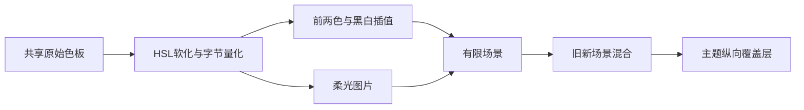

# Sollin 柔光贴图与四场背景的静态边界

全局背景在共享三色取样后软化颜色、生成144×144柔光图，再创建四个运动色场；底层渐变与色场具有分开的运动参数。E026/E027恢复有限数学和绘制边界，后续E028修复工具漏读，补齐锚点、颜色与曲线字段。后续E029恢复旧新场景替换/结束/清理边界；精确随机序列、完整异步载入与参考运行仍未验证。音枢原创实施及验收另记在文末，不由静态恢复推导等价。普通逆向报告，flavor=null。

## 范围、来源与复现

用户提供的离线IPA scope、固定skill提交/工具及禁止私有服务探测边界见[强制工作流](REVERSE_SKILL_WORKFLOW.md)。本批新路由为work/master-route-20261018-064925，实际PRIMARY为R2/mobile-reverse；保持既有work/sollin-ipa/scope.md，不重新初始化。样本SHA256为`c2ee2deba236ef1b9e097e1d8cdc0b816137aa57cf85d4c8e2811dae9924bc07`，App成员为`640c6112584c017b45141a038f7aa975224c8b540ef1aaec1f40939a6aa5c84d`。导入和依赖证据沿E001/E002，Dart3.12.2及NO_CODE_ANALYSIS工具限制见[IPA记录](SOLLIN_IPA_ANALYSIS.md)。原始字节、工具、索引与输出仅留忽略目录。

| 证据 | Finding → Path | 核验范围 |
| --- | --- | --- |
| E026，scene-color-evidence.json；SHA256 `a50461ab9407f2888a6117c6bbc36c4353c2153870b205dd817df8c8245be481` | F025 → P025 | 900原始ARM64指令、10选定BL、16池加载、3个原始getter；HSL软化、贴图和种子 |
| E027，scene-geometry-evidence.json；SHA256 `0510f691cd286e3b4c9832871832565c0a5986569ca71270555ec26e1dafb98a` | F026 → P026 | 1296原始指令、109BL、58池加载；四场构造、几何与绘制边界 |
| E028，unboxed-scene-fields-evidence.json；SHA256 `85162e5228fa9f859dcbd446ced97d10be5365d4e5873ae63dfc1339bb5e4ee8` | F027 → P027 | 工具单文件步幅修正、完整锚点/颜色/曲线、原始池加载及函数/名称/分派一致性 |
| E029，scene-transition-evidence.json；SHA256 `e3f9fbc8aee6b533b20207547ba2380baa3b4975acb8bcc17dc3a5b4024ff869` | F028 → P028 | 362原始指令、42BL、12池加载；旧新交接、timer/释放与共享空函数 |

E→F→P完整条目在本机case report/global-background.md，关联WI002及追加timeline，field-journal/scene-primitives-alias.md保留方法纠错。E026/E027初次严格review为27E/26F/26P、8WI/54事件，后续E028复核见下；独立重放日志与不可变收据均保留。审查通过证明记录一致与哈希有效，数学结论仍由逐指令审阅负责。

在该固定本机案例下可重放以下命令；生成器只允许首次创建收据，不重复覆盖：

```bash
source scripts/environment.sh
python3 build/verify-scene-color-evidence.py
python3 build/verify-scene-geometry-evidence.py
python3 build/verify-unboxed-scene-evidence.py
python3 build/verify-scene-transition-evidence.py
node scripts/sollin-reverse-gate.mjs ipa --review
```

## E031 精确种子随机补证

新R2/mobile-reverse路由master-route-20261018-093241及既有offline scope通过；E031→F030→P030不可变收据SHA256 `af0f6d6b16e53d8acfaa73bc280266f85dc84f1209e0098ecb79a911f1d50696`。五函数226原始指令，有限寄存器解释与独立unsigned64公式在8种子/272unit一致。采纳前严格review31E/30F/30P、9WI/63事件零错误警告。

seed混洗为64位逻辑移位/溢出，结果零用0x5a17，预热4次；state=0xffffda61×low32+high32。nextInt的power-of-two分支给出原始low32掩码；nextDouble两次tagged max为0x8000000/0x10000000，即**高26位/低27位**，组合(high×2^27+low)/2^53。E027此前“27/26bit组合”只表示组成量，现明确其顺序，未改写不可变收据。四场消耗32unit，随后20+10U、2πU、nextBool(true→+1,false→−1)。音枢identity命名空间独立，不宣称跨产品同歌曲同轨迹。

这只是离线ARM64有限解释，不是参考App执行、完整DartABI模拟或SDK Random源码核验；未种子分支和一般非二幂nextInt未采纳。按[0056](decisions/0056-seeded-ambient-rotation.md)原创接入随机/已核锚点/全场旋转，HSL/双色/主题覆盖层仍待，完整App/云端/手机另验。

## E032 软化色板、双色基底与最终覆盖层

新路由master-route-20261018-101821继续为R2/mobile-reverse，既有离线scope/case-guard及采纳前严格review通过：32E/31F/31P、10WI/66事件，零错误/警告。E032→F031→P031收据color-composition-evidence.json，SHA256 `8932dbb247043b9c98c0b0ef86c22573f25ffe3102117e3549d7186322c8ae1c`，观测时间2026-10-18T10:27:28+08:00。原始输出只留本机work；沿本报告固定样本/成员摘要和scope，未重新初始化或探测参考服务。

新增四个辅助函数862条原始指令：GrowableList.first 0x2b4a48..0x2b4ab0、Color.lerp 0x2298bc..0x229d60、HSL.toColor 0x25a1cc..0x25a31c、colorFromHue 0x25a31c..0x25aa38。7个直接BL和10个池加载与原始字节/固定函数边界一致。E030构造在0x4b4880软化每个颜色并加入列表，同一列表既生成柔光图片，也在0x4b4c44/54传入sceneCreate。

first辅助明确返回索引0，第二基底选择索引1（列表仅一项则复用first）。HSL.toColor用chroma=(1−abs(2L−1))×S、x=chroma×(1−abs((H/60)%2−1))、m=L−chroma/2，六个色相分支后对alpha/RGB使用LibcRound得到字节，再存为字节/255的sRGB浮点。**先软化并量化，再浮点插值**，不能用原始RGB直接插值或沿用音枢安全浅色映射。

本批只核非空且同为sRGB的Color.lerp路径，组件为a×(1−t)+b×t并限制0..1；暗色第一/第二分别以.45/.54向黑插值，亮色以.5/.6向白插值。已独立解释三个原始RGB算术片段，并以分离的色相分段公式重放20组HSL/量化/基底向量。E028的黑4/255→24/255或白18/255→48/255纵向覆盖层在两个场景绘制之后；产品应放在两场混合层外。E027的场透明度已含单场因子，当前产品额外.42仍是明确待消除差异。



复现：`source scripts/environment.sh`后执行`python3 build/verify-color-composition-evidence.py`及`node scripts/sollin-reverse-gate.mjs ipa --review`。F031为info/reverse_algo、validated/high，仅限上述静态路径；P031为原始色板→量化软化→基底/柔光→两场→覆盖层的callflow。相关WI010及timeline第66事件、field-journal均已追加，E026–E031不可变收据保持。

宽色域、null/error插值、完整Dart/Flutter执行、GPU色彩空间、有效参考主题、原始像素和能耗仍未核。**当前尚无本批产品采纳**；下一步按五固定参考/许可/Android职责记录后原创接线，并分别进行数学、原生、真实App像素与活动/异步回归。音枢语义文字颜色继续独立，完整A04不计完成。

图表保留可编辑Mermaid源码，已检查节点/连线语法；本机render_diagram.py尝试因缺mmdc退出1，未生成或宣称SVG渲染成功，未安装全局工具。该限制不影响原字节/数学证据复核。

## E026 软化与贴图数学

HSL.fromColor及withSaturation/withLightness的原始字段支持饱和度与亮度身份。当s<0.06时，亮度改为Brightness枚举0的0.34，否则0.72；此处只记录枚举0，不声称实际恢复的用户主题。其他颜色的s′为`clamp(s×0.76,0.26,枚举0?0.6:0.48)`；L′为`clamp(L×0.12+(枚举0?0.32:0.62),枚举0?0.31:0.62,枚举0?0.41:0.74)`，最终经HSL.toColor返回。

贴图两轴循环均为144，中心/归一化半径72。令`r=sqrt(((x−72)/72)²+((y−72)/72)²)`，`u=1−clamp(r,0,1)`，alpha为`(u²×(3−2u))^1.15`。RGB写入round(channel×255×alpha)，alpha写入round(255×alpha)；为预乘RGBA。固定Dart SDK提交d684a576a6aa954ae107a03b2b4e1d61c3bebe93的ARM64 PRODUCT非压缩指针线程字段顺序独立支持LibcPow偏移0x738、LibcRound偏移0x768。它们是SDK交叉核验，未执行目标绘图或观察原始像素。

种子初始0x811c9dc5，对字符串的每个单字节或双字节code unit执行`((seed xor unit)×0x01000193)&0x7fffffff`。不能替换成UTF8字节或标准uint32 FNV输出并宣称等价；Dart Random精确输出仍未验。

## 四场与合成

构造循环固定4场，图片索引循环使用输入列表。每场有锚点、二维振幅、两个周期、相位、宽高因子及透明度。已核范围为：振幅x=0.15+0.1U、y=0.13+0.09U；周期x=9+7U、y=12+9U；相位2πU；宽因子0.9+0.22U、高0.62+0.18U、透明度0.62+0.1U。U代表有限随机抽样，未保证跨语言随机序列一致。全场旋转另有20+10U周期、2πU相位和±1方向，不能与单场周期混淆。

令a=2πt/x周期+相位，b=2πt/y周期+0.73×相位。横向运动为`sin(a)+0.38sin(1.65b+0.4相位)`，纵向为`cos(b)+0.34sin(1.35a−0.6相位)`；分别乘振幅、加锚点并按视图宽高缩放。令z=sin(0.82b+相位)，呼吸项q=1+0.12z，贴图矩形宽为maxDimension×宽因子×q×(1+0.08z)，高为maxDimension×高因子×q×(1−0.06z)。原始贴图实际输出及GPU插值尚未观测。

paintScene对透明度≤0.002返回；先绘制沿全场旋转方向、以中心±0.65×maxDimension为端点的双色渐变，再save→中心平移→旋转→1.12缩放→反向平移，按各场矩形绘制柔光图，透明度为场景权重×单场透明度，最终restore。上层paint以互补权重绘制旧/新场景，之后另绘主题相关的纵向覆盖渐变；运动关闭分支使用时间0和完整当前权重。仅绘制边界与有限数学已核，完整有效状态、过渡开始/结束及资源替换仍需关联生命周期证据。

## 工具与解释纠错

Color红色浮点getter分派索引2731的canonical名称是SystemTextScaler.textScaleFactor，但其两条原始指令仅返回字段0xf；结合Color接收对象与分派索引才支持r含义。绿色/蓝色索引2737/2725分别返回0x17/0x1f。去重函数名不能独自证明接收类型。

紧凑对象输出只给锚点横坐标0.12/0.88/0.32/0.82，未给完整纵坐标；部分Color分量也缺失，不能补成猜测值。E027不可变收据曾将标准Cubic控制点写为0.645/0/0.355/1；本次pool实际只打印0.645/0.355，因此其余两个控制量未被采纳为样本恢复结论。原收据保持不变，E027登记、Finding与timeline已明确这一限制。

## E028修正：非压缩字段步幅

新路由work/master-route-20261018-073220仍为R2/mobile-reverse，既有离线scope未重初始化。固定Blutter0039efb1的dumpInstanceFields在未装箱分支和公共循环各增加一个指针字长；本样本非压缩8字节模式因此每次前进16字节，跳过相邻字段。独立工具仅将该分支改为`sizeof(uint64_t)−kCompressedWordSize`，加上公共循环后两种指针模式均前进8字节。原工具、输出及旧收据未改。

独立修正版CLI帮助和deny-network解析通过，二进制SHA256为`351db11eecbf0d7670d3e482281deb29ed1167213a6b7d19fc7a391c9a30e6fb`。逐源文件比较仅DartDumper.cpp一处改动；36,392条函数边界、36,928条命名记录及完整dispatch字节与原输出一致。整个addNames含新字段注释/ASLR，不要求原文一致；初次全文比较和误把73,320当命名数的失败均保留，后者实际为两类记录之和，不是唯一函数数。

新字段恢复四个锚点，顺序为(0.12,0.18)/(0.88,0.38)/(0.32,0.84)/(0.82,0.92)。Cubic四字段实际为(0.645,0.045,0.355,1)，明确纠正E027收据中的y1=0推断。Brightness枚举0名称为dark；黑/白Color完整分量与sRGB字段恢复，主题覆盖渐变分别为黑色alpha4/255→24/255及白色18/255→48/255。四处原始池加载指令与E027重核，新字段独立读取通过；严格review为28E/27F/27P、8WI/55事件，零错误/警告。这里只补元数据，不等于有效用户设置或原始画面观测。

## E029：场景交接、结束与清理

新路由work/master-route-20261018-075534为R2/mobile-reverse；复用既有离线scope并通过前置门禁。E029→F028→P028收据scene-transition-evidence.json，SHA256 `e3f9fbc8aee6b533b20207547ba2380baa3b4975acb8bcc17dc3a5b4024ff869`。独立重放362原始指令、42BL、12池加载及manifest通过；严格review29E/28F/28P、8WI/56事件零错误/警告。

install先取消两个既有timer、清重试量并释放旧场景。动态分支把当前场景移入previous槽，再安装新场景，以Stopwatch微秒除以1e6写起点，随后同步帧timer并创建raw整数600000的Duration定时器，与E027绘制0.6区间一致，但没有测量实际墙钟延迟。完成回调先清previous槽再释放，只在State仍挂载时请求setState。关闭动态的分支直接释放当前、清previous、安装新场景并写起点哨兵-1000；clear同时清两槽后逐一释放资源。

完成回调的池项canonical名称是Shader构造器，但原始两指令只是返回null，属于共享空函数，不能解释成创建Shader。sceneDispose有图片集合移除/最后引用释放边界，未观察实际GPU释放。didUpdateWidget的0x17字段身份变化，或0xf字段经分派判断不相等，会重新resolve；字段业务名及完整异步load/retry/迟到结果守卫未恢复，不据此宣称切歌异步正确或参考运行等价。本补证不改变当前原创产品的同步场景替换策略。

## 原创实施的下一步

音枢应先记录五个固定参考的图层、资源、动画停止、Android及许可取舍，再设计有界原生柔光场景。可明确采用自己的锚点、随机与文字对比度策略，但必须与参考已核结构分开记录；不能把场景软化色直接替换现有语义文字背景。保留图片身份/迟到拒绝、缓存预算、全屏可见拥有者、暂停/缓冲、后台与减少动态效果门控，唯一队列和原生音频不变。新增实现需独立数学/原生与App像素、切歌、跨页、停止/恢复验收，之后分别做清洁归档和对应iOS27验证。

本批无产品改动，不增加A04完成度，不重复以打包代替播放验收。参考运行、完整视觉等价、能耗/帧率、真实服务、签名和真机均未验证。上一三色批次的本地验收及云端排队状态见[构建记录](BUILD_STATUS.md)，不由本报告扩展其结论。

## 原创实施跟进（与静态收据分开）

[0054](decisions/0054-native-ambient-soft-lights.md)记录五参考重核与采纳前取舍，原创增加有界四场原生柔光层，仍使用现有三色基础渐变和语义明暗色，不采纳HSL软化/参考锚点/参考随机/完整旋转合成或过渡曲线。原生独立数值/实际栅格专项、完整native和366业务/类型通过；最终图层版正式App354.349秒通过，含实际暂停/播放像素、两页三色、PCM/前后台、播放中独立开关及恢复清理；12合成鉴权成功/0失败，无新stream，复用临时音频缓存。最终完整native再次退出0；清洁IPA和对应iOS27继续。不以这些原创测试推导参考运行等价。

## 异步成功路径、所有权与有限重试（E030）

新R2/mobile-reverse路由master-route-20261018-082723、既有离线scope与前置门禁后，E030→F029→P029收据scene-async-evidence.json，SHA256 `4c31bae1239d5becc3270512232d1104cabf63f97b8c9c6f148ccc758dd01911`。7个函数954条原始指令、107BL、15池加载与边界独立重放通过；严格review30E/29F/29P、8WI/58事件、零错误/警告。独立验证器初次误将比较指令当作字段加载而失败，修正为前一条加载后通过，原始收据未改。

resolve修正并归一化封面键，通过分派比较当前键，移除旧监听器、清句柄、保存新键并增加未装箱世代0xa7；空键清场景。分为resilient bytes和普通ImageProvider两支，普通支包含160×160/fit元数据。resilient在bytes await后检查挂载与世代，解码codec/取frame后再次检查；迟到图像与codec有释放分支。普通成功监听器检查一次消费布尔、挂载和世代，再标记消费并创建场景；错误监听器匹配世代后调用retry。

createScene取3色并逐一await柔光图像，完成后再核挂载/世代，才计算种子/构造/安装。过期或错误分支遍历生成的图片句柄，移除引用并在最后引用时释放；源图像是否释放由所有权布尔区分。retry检查挂载、原始计数小于2，递增并取消旧timer，使用Duration原始整数3000000；回调挂载时清活动键并重新resolve当前widget。只证明静态延时参数，不是墙钟或网络退避实测。

边界：resilient外层catch在0x4b455c后直接调用retry，调用点没有立即比较世代；不能由成功路径守卫推断所有错误路径均拒绝旧世代。内部bytes/provider URL/网络/缓存协议、widget两字段业务身份、全部异常所有权与运行资源释放仍未核。该批没有产品修改，当前原创同步场景策略保持；参考App、完整视觉/旋转/Random、帧率能耗、真实服务/签名/真机均不由此补齐。

## 0055 有界过渡采纳与独立画面验收

新路由master-route-20261018-084017及既有离线scope后，E028→F027→P027曲线、E029→F028→P028有限场景交接、E030→F029→P029成功路径/监听器边界独立重放并过采纳前strict review；依[0055](decisions/0055-bounded-ambient-transition.md)采用原创pending显示交接与两场整体0.6秒过渡。未复制参考网络/helper、完整异常或随机实现；原abort/URI隔离更严格，不把外层catch误称全路径世代保证。

368业务/类型与最终完整native通过。正式App1792285502088完整背景388.381秒通过1/0/0，HTTP屏障验证等待保留/迟到隔离/失败回退；原停止/播放/三色两页/PCM/前后台/重启/开关/清理均通过。独立simctl录屏逐帧解码65帧、11中间色，蓝0/红0.563333秒阈值穿越，预览已亲看；不推算FPS/精确过渡时长或参考像素一致。15次本机合成鉴权成功/0失败，无新stream、复用临时缓存音频。

第一完整App三色像素断言失败揭示CAGradientLayer单位投影与原CGGradient物理投影差异，修正宽高比端点并保留断言后通过；失败/Pods上游探查切源码和零测试构建日志保留。无依赖锁迁移。清洁设备归档、push、对应iOS27另记；完整旋转、精确Random、参考运行、真实服务/签名/手机/能耗继续待验。
