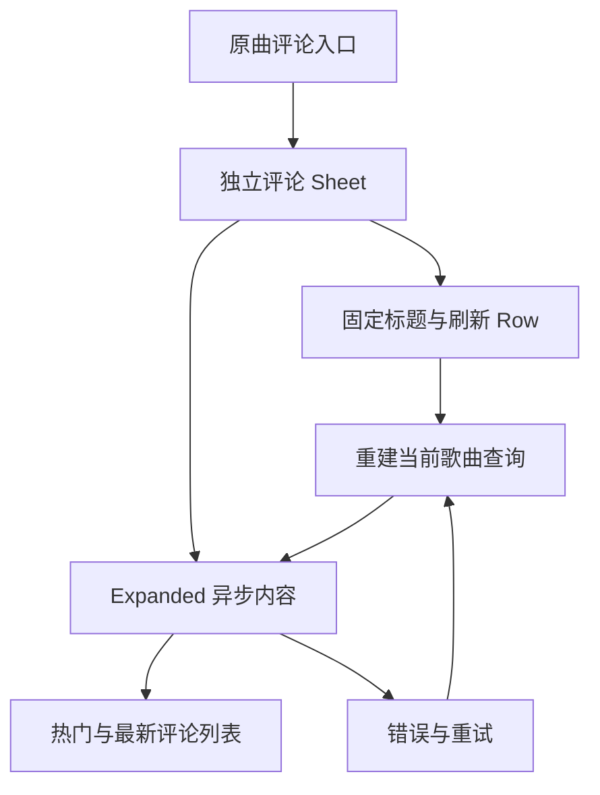

# Sollin 评论弹层与列表层级静态报告

2026-10-18；普通逆向报告，flavor=null。仅分析用户提供的 Sollin iOS 2.0.0/build60 离线样本，不运行参考 App、不访问其私人服务。本批原始指令支持独立评论 Sheet、固定标题/刷新行、列表内热门/最新分区，以及当前歌曲查询的重新加载。音枢据此原创调整已有评论 UI，仍保留原曲身份、分页失败留旧内容和关闭取消。静态结果不证明真实接口、精确运行高度、动画、头像/点赞写入或完整分页协议。

## 授权、来源与方法

遵循[项目门禁](REVERSE_SKILL_WORKFLOW.md)。新路由 `master-route-20261018-173019` 命中 R2/mobile-reverse，既有 `work/sollin-ipa/scope.md` 为 granted/offline/ready，仅允许给定本地样本的静态分析。没有重跑 case-init、扩大网络范围、安装工具或修改全局配置。参考 IPA SHA256 `c2ee2deba236ef1b9e097e1d8cdc0b816137aa57cf85d4c8e2811dae9924bc07`；App.framework/App 成员 SHA256 `640c6112584c017b45141a038f7aa975224c8b540ef1aaec1f40939a6aa5c84d`。

沿用固定 reverse-skill `cab634bd855fc287f6e420c1f36fd1a6b9245960`、隔离 Blutter `0039efb1b29d68ca6e5caece4d412d15e6f49428` 的 unboxed 元数据输出与索引 cstool。cstool SHA256 `8a1c8147b1e1b326d8071406dd90ea43cad0aefadde1319d330f8bb397ecc907`。每条指令与原始成员 slice+0x4000 对齐，独立重放函数边界、直接 BL、对象池偏移及子节点存储。方法先例仅用于流程，不作本功能互证。原始反汇编、对象池、manifest 和案例全部留忽略目录，不进入仓库或产品。

## Evidence → Finding → Path

| Evidence | Finding | Path / 核验结果 |
| --- | --- | --- |
| E-033，8函数827原始指令、70直接BL、60池条目；不可变manifest SHA256 `e22d0159db751d0dec276b72d58798978b586a0422eb4e8977921099f657f9c5` | F-032：独立Sheet入口、固定Row和Expanded列表、热门/最新分区、当前歌曲重新查询 | P-032：核原始入口/分配头→追Column子节点→追列表闭包与invalidate→review后原创实现，App独立验收 |

案例 `work/sollin-ipa/report/comments-sheet.md`、`workitems.md` 的 WI-011、`timeline.md` 和现场日志已追加。采纳前 `ipa --review`：33E/32F/32P、11工作项/75事件，零错误/零警告。review证明证据结构与摘要一致，具体语义另由原字节与数据流核查支持。

| 地址 / 函数 | 静态结论 | 限制 |
| --- | --- | --- |
| `_showSongCommentsSheet` 0x3302ec；factory 0x336194 | BL0x330354到themed modal bottom sheet 0x330370；factory分配SongCommentsSheet 0x3361c8 | 命名参数描述包含isScrollControlled/showDragHandle，本批不据描述单独推断所有有效参数或实际屏幕高度 |
| `_SongCommentsSheet::build` 0x458b04 | 标题Expanded和刷新IconButton组成Row；Column第一子节点为Row，末项为Expanded AsyncValue；标题字符串后缀“ · 评论”、style22/ellipsis | 名称和字符串不是唯一依据，另核分配/slot数据流；原生iOS Sheet为音枢适配，不称精确Flutter几何等价 |
| loaded 0x458f64；row 0x459364 | loaded建立ListView.builder；row的两个分支返回热门/最新标签或CommentTile | 不采纳未知动态调用语义、服务字段与分页能力 |
| header/error callback 0x4596a0；loaded-error retry 0x459570 | 两者重建SongCommentsQuery/family并调用invalidate 0x34a030；header和error共享前者 | 不能因此声称远端重试成功、认证或缓存时效已核 |
| error builder 0x459624 | AsyncStateBlock与“评论加载失败 / 请检查网络后重试。/ 重试” | 音枢仍使用自己的错误脱敏与保留旧内容策略 |

加载闭包0x404d10的canonical名称来自FM页面，不据此推导评论会执行FM业务。没有原始App运行或截图证明本批精确几何；早期九图未包含评论页，不用其他页截图补造评论细节。



## 原创实施与验收

取舍及五参考固定HEAD/许可/维护/Android边界见[0063](decisions/0063-comments-sheet.md)。仅调整已有容器、固定头、图标与虚拟分区列表，不改变公开评论协议、游标、上限、原曲归属或权威播放队列。AM2继续内嵌相同内容，不额外开启Sheet；独立Sheet提供关闭和系统下滑收起，窗口安全区用现有safe-area-context。

387项业务/类型检查通过。App旋转/分页恢复/固定头/原生关闭专项、本地清洁unsigned归档和对应云端iOS27以[构建记录](BUILD_STATUS.md)及[交接](../HANDOFF.md)的实际终态为准，未通过前不计完成。真实平台、签名、真机和参考App运行等价仍独立待验。

## 本机复现

以下从项目根执行，依赖已授权且已索引的工具、原始样本及忽略目录输出。独立verifier固定E033摘要，不以重新生成同名manifest代替完整性检查。

```bash
source scripts/environment.sh
node scripts/sollin-reverse-gate.mjs ipa
python3 work/sollin-ipa/notes/comments-probe.py
python3 build/verify-comments-evidence.py
node scripts/sollin-reverse-gate.mjs ipa --review
npm run check
node scripts/test-ui.mjs NexusMusicUITests/SourceSettingsTests/testPublicComments
```

未搜索外部知识，无新增社区发送；案例现场日志和索引已写回本机，整体项目仍在实施。
