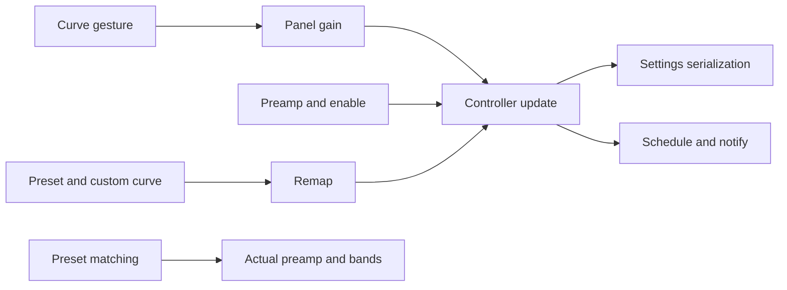

# Sollin EQ 控制器与实际预设状态证据

2026-10-18，普通移动逆向，flavor=null。此批是新增静态证据与现有实现审查前提，尚无新产品实施或验收声明。

reverse-skill固定cab634bd855fc287f6e420c1f36fd1a6b9245960；原生master-route的ipa-equalizer-controller路由R2/mobile-reverse。已读PRIMARY、工具索引并通过项目门禁/case-guard，复用已授权离线scope，无目标网络或App运行。IPA SHA256 c2ee2deba236ef1b9e097e1d8cdc0b816137aa57cf85d4c8e2811dae9924bc07；App.framework/App成员SHA256 640c6112584c017b45141a038f7aa975224c8b540ef1aaec1f40939a6aa5c84d。VA为arm64 slice偏移，FAT原文件加0x4000。

## Evidence→Finding→Path

E021 evidence/eq-controller-state-evidence.json摘要4ee6210e3bc3060b13a37674e31d5cbd49cb7224904c9643bed461eb9d829c23，观察2026-10-18T03:26:37+08:00；F020 info/design、candidate/high；P020从控件到权威状态更新再独立验证。WI007重新in_progress，timeline34。采纳前strict review21E/20F/20P、7WI/34事件、零错误/警告。

索引cstool5.0.3/Python3.12.14通过notes/eqstate-probe.py和eqstate-evidence.py限定解码、独立核对4433条原始指令字节、18条BL及ADD/LDR（含浮点LDR）池地址。Blutter NO_CODE_ANALYSIS骨架只标识归属，不能称完整反编译；不可变收据拒绝覆盖。原始样本/字符串/输出和scope.md/workitems.md/timeline.md均留忽略work/sollin-ipa。

| 位置 | 已确认及限制 |
| --- | --- |
| 0x669660/669104→0x669184，0x6696a4/669148→0x6688ec→0x6689a4 | 两曲线回调先计算gain，再走面板/控制器路径；完整手势取消/几何未恢复 |
| 0x668bfc、66ef84、66f140、66e5b8、66eb3c→0x668cd0 | 单频段、前级、启用、曲线和命名预设汇入同一update；曲线/预设先remap |
| 0x668d40、668d64、668e0c、668e14 | 更新field0x3f、toJson、scheduleApply、notify；异步闭包与后端实际执行/持久化回滚分别待核 |
| 0x66c768、66c76c/778/77c、66c880与pool3df58 | remap后比较前级field0xf与每频段差值；原始浮点池值0.06，不能只按预设名选中 |
| pool52678/52680、0x66f04c/050 | “归零”闭包明确传入浮点0到setPreamp |
| pool526d0、529c8及0x66ecd4 | 另一回调通过“平直”名称进入setPreset；完整构造默认值与运行有效结果仍须独立核验 |

参考商业配额/赞助分支不采纳，参考内置曲线和后端实现未复制。音枢保持既有七预设/24自定义、±12dB、安全余量、原子仓储、唯一DSP/队列和释放提交/取消回退。下一步先比较五参考，再核验当前选中态、归零/重置/旁路及失败保护；不据本证据直接宣称声音或UI对齐完成。真实服务/签名/手机另验。

图仅覆盖静态已证实调用；参考原生音效/异步失败和运行时未包含。docs-generator普通逆向结构，diagram-generator可编辑Mermaid；无恶意样本或ATT&CK适用项。

本机图渲染脚本返回缺mmdc，保留源码，未安装或声称图片已渲染。原始流程journal见本机field-journal/eq-controller-convergence.md。
