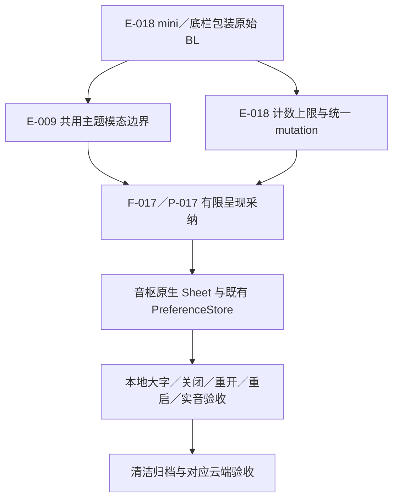

# Sollin mini 与底栏设置模态边界

2026-10-18，普通移动逆向，flavor=null。E-018只支持现有设置的模态呈现和有界按钮职责，不代表已实现参考全部九按钮、三类底栏或动态运行等价。

## 范围与复现

reverse-skill固定`cab634bd855fc287f6e420c1f36fd1a6b9245960`；原生master-route输出`build/reverse-skill/routes/ipa-mini-controls/route-scope.md`，PRIMARY mobile-reverse。沿既有授权离线scope，未覆盖case-init，case-guard/工具索引/项目门禁通过。IPA SHA256 `c2ee2deba236ef1b9e097e1d8cdc0b816137aa57cf85d4c8e2811dae9924bc07`，成员App.framework/App SHA256 `640c6112584c017b45141a038f7aa975224c8b540ef1aaec1f40939a6aa5c84d`。arm64 slice VA在本批__TEXT内等于slice偏移，FAT raw另加0x4000。

索引Python3.12.14/cstool5.0.3执行限定解码；固定Blutter0039efb1/Dart3.12.2 no-analysis骨架仅归属地址，不能称完整反编译。`notes/mini-probe.py`输出限定函数；`notes/mini-evidence.py`独立核原始BL、1844条指令的原始字节及具体池项，不可变收据拒绝覆盖，重放须新文件名。原始脚本/输出/样本仅留本机忽略目录，不请求Sollin服务、不启动App、不提取凭据或复制商业逻辑。

`source scripts/environment.sh`后执行`node scripts/sollin-reverse-gate.mjs ipa`，补齐工作项和时间线，再加`--review`严格审查。采纳前18E/17F/17P、7工作项/29事件、零错误/警告。

## Evidence→Finding→Path

E-018 `evidence/mini-settings-evidence.json` SHA256 `4b25c89fc38abb554869822b32ea05384a32b815ea064771ca39d6976641e1cb`，观察02:34:48。F-017为info/design、candidate/high；P-017沿外观入口→原生模态呈现→已有受限控件→音枢独立验收。

| 原始位置 | 确认内容与限制 |
| --- | --- |
| 0x3a53e0/0x3a5c7c→0x330370 | mini按钮与底栏样式包装直接调用已由E009核验的主题化modal包装；pool47ff8/48000、48038/48040分别为构建闭包/Sheet对象 |
| 0x3a58f8–8fc | 累积计数与4比较、相等时停止；空列表0x3a5910–928使用pool48268两元素fallback；这是声明/标准化策略，不是用户当前有效值 |
| 0x45e278–284、0x45e3bc–3f8 | 计数与4比较，决定添加callback/null及“添加按钮”/“已达到4个按钮上限”标签；完整几何和点击动画未证实 |
| 0x3a5788、0x45ee00/0x45ee1c | load调用normalized；setActions先normalized、状态发布helper，再saveSettings；不能推断异步保存失败后的参考行为 |
| 0x45ed9c/0x45f100/0x45f794→0x45edd0 | 添加/排序/移除闭包汇入同一setActions；音枢原子仓储和必留播放暂停策略继续独立 |
| 0x422874、0x4228cc、0x42291c、0x4229c4、0x422a28 | 控件激活有队列、上一首、下一首、播放模式、评论的独立路径；骨架名称和pool九枚举不自动转成音枢新增能力 |

本批没有完整恢复三种BottomBarStyle的几何、九种动作标签映射/所有回调、实际保存恢复和完整手势。音枢目前五种可配按钮、最多四个且必留播放暂停、默认播放暂停/下一首、原曲收藏与实际录音歌词保持自身契约。

图中的采纳与音枢验收是独立步骤；不表示已动态运行Sollin。完整原始授权scope与timeline保留于本机忽略目录`work/sollin-ipa/scope.md`、`timeline.md`。

## 原创实施与验收

按[0044](decisions/0044-mini-navigation-settings-sheets.md)只将现有mini和底栏设置从叶页改为原生pageSheet，复用现有PreferenceStore和控件。外观分类/滚动保留，关闭/系统dismiss/重新打开各自独立session，隐藏底页不接触摸/AX；保存错误保留原值。348业务/类型检查通过；正式入口`SourceUITests-1792262213912.xcresult`三项通过、零失败/跳过：mini/底栏最大辅助字号关闭/下滑/重开/滚动/重启159.603秒，主题46.171秒，Navidrome合成实音/PCM/八布局/暂停定位/mini四项上限排序/原曲收藏/实际录音歌词/重启/恢复默认并关闭后验证队列按钮消失/凭据清理242.101秒。已亲看mini与底栏大字Sheet和真实四按钮mini截图；大字长内容仍需滚动。未修改原生播放/脚本后端，无新依赖。清洁归档/push及对应iOS27继续；真实服务、签名、真机和完整参考运行等价仍待。参考运行/完整选项等价、签名与真机仍未通过。

使用docs-generator结构和现有Evidence契约；五参考职责、维护/Android/许可比较见决策，无源码/依赖/原生补丁引入。全部A/F/J与音枢特有功能保留。

报告中的Mermaid关系图保留可编辑源码；本机缺少mmdc，渲染脚本已报告缺失，未安装工具或宣称SVG已生成。

本批实音回归鉴权8次成功、0失败，未新增stream请求，允许命中既有临时音频缓存；不称本次冷下载。
