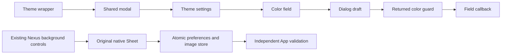

# Sollin 主题设置模态与调色返回边界

2026-10-18，普通移动逆向，flavor=null。reverse-skill固定cab634bd855fc287f6e420c1f36fd1a6b9245960，原生master-route的ipa-accent-picker选中mobile-reverse；复用已授权离线样本scope，工具索引/case-guard/项目门禁均通过，无目标网络或App运行。

## 复现与证据

IPA SHA256 c2ee2deba236ef1b9e097e1d8cdc0b816137aa57cf85d4c8e2811dae9924bc07；App.framework/App成员SHA256 640c6112584c017b45141a038f7aa975224c8b540ef1aaec1f40939a6aa5c84d。本批VA等于arm64 slice偏移，FAT原文件加0x4000。索引cstool5.0.3/Python3.12.14限定解码；Blutter NO_CODE_ANALYSIS骨架只用于地址归属。

本机notes/accent-probe.py及accent-evidence.py独立核对3044条原始指令字节、BL、池ADD/LDR和分配头；不可变E020 evidence/theme-color-presentation-evidence.json摘要463b387831e0d6e03dae4ea711c07f3d68a9fbf43ec4a1ca458549afbdb68423，观察2026-10-18T03:14:33+08:00。原始样本/输出/字符串保留忽略work目录，不提交或打包。

| 位置 | 静态确认与边界 |
| --- | --- |
| 0x3a67f0→0x330370，工厂0x3a680c | 直接复用E009模态包装，pool48090为ThemeSettingsSheet |
| 0x465148/4654a4/465e94→0x466208 | 构建分配三处class4570颜色字段；不能据此推完整选项或默认值 |
| 0x65f430→0x65f4dc→0x1e52bc | 字段await调色器，后者调用Flutter showDialog；工厂0x65fdf4分配class4449 AlertDialog |
| 0x65f444/448/450 | 返回null与当前State上下文检查后才继续字段回调；不等于持久化失败语义 |
| pool59980/59988、0x65ff70→0x339464 | “使用此颜色”按钮闭包将捕获颜色经Navigator.pop返回；其他相邻地址不冒称取消/确认 |

E020→F019 info/design candidate/high→P019现有入口/原生弹层/独立验收。workitems WI002及timeline33更新；采纳前严格review20E/19F/19P、7WI/33事件，零错误/警告。完整HSV/default、几何、有效恢复值、运行和存储失败继续待核。

## 原创实施范围

只采纳现有背景设置的模态边界，调色器证据保留待独立实施；五参考比较、许可/维护/Android与验收见[0046](decisions/0046-theme-background-sheet.md)。现有背景设置原生Sheet已实施，使用既有图片/偏好职责；348业务/类型检查通过。首轮1792264933860四项App通过后，截图发现最大辅助字号预览裁切和按钮越界；原创修为预览minHeight随文字增长、窄屏/大字纵排、44点触控，未修改原生音频或增加依赖。最终1792265663902真实Files导入/删除/重启102.911秒通过；同组新增预览查询因父子同名失败，限定firstMatch且保留全部几何断言后，1792265870384最大辅助字号86.835秒通过、零失败/跳过。实测两按钮修改/恢复值、预览文字边界、关闭/下滑/重开/分类位置/重启，亲看最终预览及控件截图；长页滚动导致边缘内容出屏不等于元素自身裁切。原失败与截图留存本机。首轮实际全局背景260.441秒/外观89.222秒、最终图片专项与大字专项分开记录，不混称最终四项全跑。首轮合成鉴权8成功、零失败，无stream请求；最终两次零网络，不计本次冷下载或真实服务验收。验收后strict review21E/20F/20P、7WI/35事件，零错误/警告；清洁归档、push和对应云端iOS27仍待，全部A/F/J及真实服务/签名/真机范围保持。

图仅表达已证实调用和本批原创职责；参考保存失败、完整颜色及运行语义不在图中。原始scope.md、timeline.md和field-journal/theme-color-return-boundary.md留本机忽略案例；报告采用docs-generator普通逆向结构、flavor=null，无恶意样本或ATT&CK适用项。

本机图渲染脚本返回缺mmdc，保留源码，未安装或声称图片已渲染。
