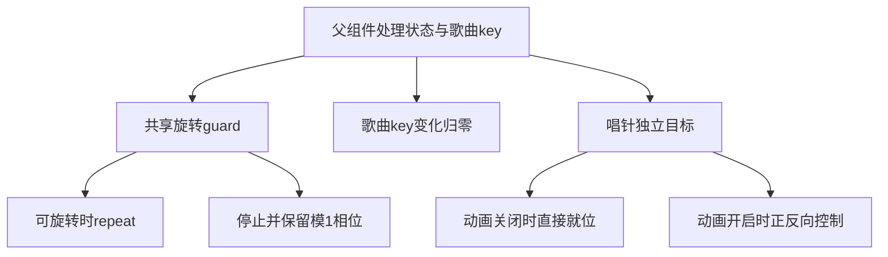

# Sollin 黑胶双控制器与生命周期静态报告

2026-10-18；普通逆向报告，flavor=null。本批定位固定IPA中黑胶组件的旋转与唱针控制器边界，为下一阶段已有UI对齐准备证据。确认初始化/更新进入同步函数，以及repeat、stop、value、forward、reverse和dispose的有限直接调用。完整标志位、参数、几何、连续手势和参考运行仍未确认，尚未采纳新的产品行为。

## 来源、授权与方法

遵循[逆向工作流](REVERSE_SKILL_WORKFLOW.md)，路由master-route-20261018-183954命中R2/mobile-reverse，既有`work/sollin-ipa/scope.md`保持granted/offline/ready；未重新case-init。仅给定本地样本静态分析，不启动参考App、不访问私人服务、不注入或安装。

固定reverse-skill cab634bd855fc287f6e420c1f36fd1a6b9245960；IPA SHA256 `c2ee2deba236ef1b9e097e1d8cdc0b816137aa57cf85d4c8e2811dae9924bc07`，App成员SHA256 `640c6112584c017b45141a038f7aa975224c8b540ef1aaec1f40939a6aa5c84d`。沿已审阅的Blutter固定源0039efb1与unboxed元数据输出，使用工具索引中的cstool；逐条对应成员slice+0x4000原始字节，独立重算BL目标、池偏移和函数边界。没有把无正文的Dart骨架当反编译。

## Evidence → Finding → Path

| Evidence | Finding | Path |
| --- | --- | --- |
| E034，8函数1544原始指令、138直接BL、114池加载；manifest SHA256 `874a5b72a54caa4315127f6d2eb2809c416ea3a8dc56203719da2fb67e1ca5b3` | F033：独立旋转/唱针控制器与有限生命周期调用边 | P033：核原字节/字段→追初始化和更新到同步→区分控制分支→保留未知参数/标志/运行→后续独立设计与验收 |

原始指令、提取脚本、manifest、案例报告、WI012和timeline仅留忽略目录。独立verifier通过；严格review为34E/33F/33P、12工作项、79事件、0错误/0警告。review只证明结构/摘要前提，语义范围见下表。

| 函数 | 有限静态结论 | 未证实内容 |
| --- | --- | --- |
| initState 0x6cf284 | 两次AnimationController分配/构造，保存到rotation与tonearm字段，直接调用sync 0x68f220 | 不按池中数值单独宣称有效时长、转速或默认交互 |
| didUpdateWidget 0x68f0f8 | 有value赋值及直接sync调用 | widget比较字段的完整身份/标志语义未恢复 |
| sync 0x68f220 | rotation字段分支可达repeat、stop与value setter；tonearm分支可达value setter、forward/reverse | 完整播放/后台/减少动态效果的布尔映射、异常和目标运行待核 |
| dispose 0x6fd254 | 对两个字段各调用AnimationController.dispose，之后进入mixin清理 | 不据此声称音频会话或全部资源生命周期已经恢复 |
| closure 0x59bc4c | 调用Curve.transform后分配TonearmPainter | 精确角度、曲线参数、触摸范围和可见几何待核 |
| closure 0x59bd60 | 分配Transform并调用旋转计算 | 不据旋转构造推导连续拖动或手势提交语义 |

sync首个直接目标的canonical名来自Acrylic组件；共享/去重名称不证明接收者属于Acrylic页面。所有推断以当前函数原始字节与字段引用为边界，不凭名称补齐业务。

## 后续实施边界

继续恢复必要标志与相位/身份切换，再按[参考比较](REFERENCE_COMPARISON.md)亲读五个固定参考的实现、维护、Android和许可后决定音枢原创实现。保留唯一播放意图、真实PCM、暂停/后台/减少动态效果、队列与数据安全；不复制AOT、资源或商业逻辑。该批静态结论不增加功能完成度，不替代本地App、云端iOS27、真实服务、签名或真机验收。

## 本机复现

需要原始样本与已固定的本机忽略目录输出，不能在干净迁移环境中伪称可直接取得它们。

```bash
source scripts/environment.sh
node scripts/sollin-reverse-gate.mjs ipa
python3 work/sollin-ipa/notes/vinyl-probe.py
python3 build/verify-vinyl-evidence.py
node scripts/sollin-reverse-gate.mjs ipa --review
```

未联网搜索目标知识或扩大scope；现场日志和案例索引随本批更新，产品采纳仍待下一阶段证据和独立验收。


## 2026-10-18 标志槽位与相位后续

新R2路由master-route-20261018-191117复用已授权离线scope，E035→F034→P034新增827原始指令、68BL、41池引用；不可变manifest SHA256 `244c0d926fd538a8d1489fa89f392e782eefbc6817e7082fa68cd0c335196286`。独立重放与采纳前35E/34F/34P严格review通过。前表的“完整标志/参数待核”由下列有限结论补充，不追溯声称E034已证明它们。

- 共享guard0x68d3ec读取widget槽0x18与0x20，返回前者且非后者。父构建0x54c544将processingState loading/buffering比较结果送入0x20；0x18来自listenable值，完整源声明仍未知，不凭Acrylic canonical别名认定接收者。
- 唱针target由0x18决定1/0，0x28控制直接value或forward/reverse；父组件继续向该动画开关槽转发自己的0x38，完整设置来源未恢复。
- 父构建调用BoardSong.key并存入widget0x40；didUpdateWidget0x68f0f8比较新旧0x40，不等时相位和controller归零。停止分支用phase+value经SDK叶DartModulo0x740按1折回；绘制closure0x59bd60使用(phase+value)*2π。初步误标Fmod在证据生成前被固定SDK断言拒绝，正式证据正确为DartModulo。
- init0x6cf284与AnimationController命名参数描述符/栈位置支持正向Duration620000、反向480000，旋转构造前LibcRound0x768得到13513514；按Dart微秒契约解释名义时长，未观察参考实际帧表现。精确ThreePointCubic坐标、几何/手势及后台/无障碍flag来源仍未恢复。



图仅表示已核静态控制职责；不表示完整设置来源、目标运行或音频调用。五固定参考/Android/许可比较与音枢原创实现见[0066](decisions/0066-vinyl-independent-motion.md)，App验证进行中，不把静态review算作产品验收。

本机补充复现（依赖固定样本和忽略输出）：

```bash
source scripts/environment.sh
node scripts/sollin-reverse-gate.mjs ipa
python3 work/sollin-ipa/notes/vinyl-flags-probe.py
python3 build/verify-vinyl-flags-evidence.py
node scripts/sollin-reverse-gate.mjs ipa --review
```
