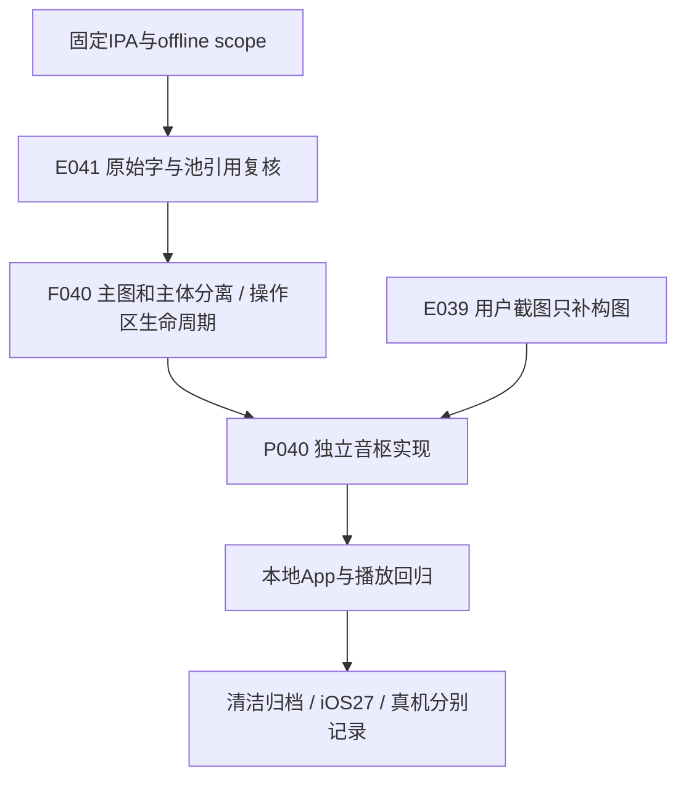

# Sollin IPA 写真歌词与操作区静态分析

2026-10-19，离线范围。固定reverse-skill cab634bd855fc287f6e420c1f36fd1a6b9245960；R2路由mobile-reverse，安装案例不替代功能证据。固定Sollin 2.0.0(60) IPA SHA256 c2ee2deba236ef1b9e097e1d8cdc0b816137aa57cf85d4c8e2811dae9924bc07，App成员640c6112584c017b45141a038f7aa975224c8b540ef1aaec1f40939a6aa5c84d。Blutter固定0039efb1/Dart3.12.2 no-analysis元数据配合原始ARM64字和Capstone5.0.3；未执行目标或连接其服务。

证据E041→发现F040→路径P040，WI015及timeline更新；严格review41E/40F/40P零错误/警告。不可变本机清单SHA256 c451dd78ebf84342634d744020e0ef368c902ae0b97e906c87cafb3f1b6e9132，1946原始指令、165BL、172成对池引用核对。原始样本、池、对象和反汇编只留忽略目录，不提交。

| 结论 | 定位/证据 | 置信与边界 |
|---|---|---|
| 显示状态与五秒生命周期 | init0x7c0208、toggle0x67c6e0、同字段0x57、handle0x5f、keepAlive0x67c89c、dispose0x70be20 | 高；过期closure检查mounted，隐藏setter直接写false；共享函数的误导元数据名称不能解释为缓存播放操作 |
| 主图/歌曲动作/歌词/快操作分离 | poster0x67ba84，HeroArtwork、SongActions、LyricSurface、QuickActions独立分配 | 高；屏高720分支的.42/.44只说明参考构图，不证明跨设备像素 |
| 隐藏时禁触摸 | 同字段读、反转布尔传IgnorePointer，opacity0/1、scale.96/1 | 高；120/140ms对象参数可见，完整手势未恢复 |
| 主图纵向渐隐 | heroLayout0x79d780、heroMask0x79de44、poster设置fullbleed字段27 | 高；cover/expand/dstIn，stops0/.5/.76/1，直接颜色alpha1/1/168÷255/0；嵌套ColorSpace字段必须排除，不能覆盖Color直接字段 |

[实现决策与五参考比较](decisions/0072-photo-lyrics-composition.md)。参考完整动作语义、手势图、动态运行和精确物理几何仍待；用户截图不证明这些结论。独立音枢实现和验收正在推进，不宣称完成真实服务、签名或真机。

## 原创音枢验收回执

395业务/类型与完整原生CLI通过。最终手机1792340980963三项3/0/0，旋转78.470秒、大字122.324秒、完整八布局/实际PCM/歌词/统计/重启/凭据清理311.934秒；21合成鉴权/0失败，无新流请求，缓存复用。五张PNG亲看，独立PNG169/90渐隐采样通过。iPad1792367266454旋转113.592秒1/0/0；前轮94.072秒失败经末段录像确认是Sheet关闭动画未完成，仅夹具限时等真实恢复。不是相同一次运行，未冒称目标运行/真实服务/真机。首轮未生效mask及中断旧代码测试完整保留；清洁归档与对应云端另记。

封面比例/坏响应补验见[0074](decisions/0074-photo-artwork-coverage.md)：最终139.533秒专项与320.837秒完整八布局2/0/0通过，独立PNG确认无拉伸、坏图无旧图、返回恢复；只属于原创音枢验收，不新增参考动态结论。
