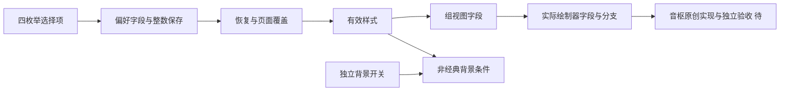

# Sollin 歌词舞台样式选择与绘制字段证据

2026-10-19，普通移动逆向，flavor=null。补查截图4871–4873对应的舞台样式选择、保存和有效绘制字段。本批恢复静态契约，没有实施新的舞台模式，不计完整特效或参考动态运行完成。

## 范围与复现

reverse-skill固定提交`cab634bd855fc287f6e420c1f36fd1a6b9245960`，macOS原生R2路由`work/master-route-20261019-083205/route-scope.md`，PRIMARY mobile-reverse。包根规则、PRIMARY、本机工具索引和当前offline scope沿项目硬门禁执行；前置门禁通过，未重新初始化已有案例、运行目标或访问Sollin服务。

固定IPA SHA256 `c2ee2deba236ef1b9e097e1d8cdc0b816137aa57cf85d4c8e2811dae9924bc07`；成员`App.framework/App` SHA256 `640c6112584c017b45141a038f7aa975224c8b540ef1aaec1f40939a6aa5c84d`。索引Python3.12.14与cstool5.0.3核对限定arm64原始字节；表内为slice VA，原FAT偏移另加0x4000。Blutter0039efb1/Dart3.12.2 no-analysis骨架仅提供边界、名称和对象元数据，不冒称完整反编译。

加载`scripts/environment.sh`，执行`node scripts/sollin-reverse-gate.mjs ipa`；索引Python执行本机`notes/stage-styles-probe.py`、拒绝覆盖的`notes/stage-styles-evidence.py`，独立冻结清单/原始字/BL/池偏移重放。更新WI-016/timeline后执行同门禁加`--review`。初次断言将组字段读取误填为紧邻的栈保存地址，原始输出显示应为0x7a1300，已纠正后才冻结；未将失败轮写成通过。

## Evidence→Finding→Path

| 项目 | 结果 |
| --- | --- |
| E-042 | `evidence/stage-styles-evidence.json`，SHA256 `60d6a07ee85680f4ab872e4697fa844b710f2308abe3d795968a8b7b24c26d9c`；6229原始指令字、455直接BL、424成对池引用及源文件清单 |
| F-041 | info/reverse_algo，candidate/high；选择、偏好、有效样式与绘制字段关系，完整特效和动态运行未知 |
| P-041 | 选择回调→保存字段→恢复/覆盖→组视图→绘制器→独立音枢设计与验收 |
| 严格review | 42E/41F/41P、16工作项/93事件，0错误/0警告；本机独立冻结重放通过 |

## 原始字段与调用链

| 位置 | 确认事实与边界 |
| --- | --- |
| 0x6031a0→0x603bd8 | 底部控制构建调用样式选择器；选择器遍历四对象列表，序号0/1/2/3分别classic/neon/cyberpunk/aurora，标签经典/霓虹/赛博/炫彩 |
| 0x603c94–c9c、0x603ff4–0x604008、0x6045dc | 每项捕获原枚举，闭包0x60460c调用styleTap0x604624；不是仅凭四个字符串推断存在四个工作模式 |
| 0x604acc、0x604ba8、0x604b7c→0x397508 | setter比较同一state0x9f，setState闭包写回；保存闭包提取枚举序号，使用`lyric_stage_effect_style`调用SharedPreferences.setInt |
| 0x7c03e8–0x7c0430、0x6d985c–0x6d98e0 | 构造偏好state0x9f为neon，有效字段state0xa7起始classic；恢复getInt，缺省序号1，整数clamp0..3后取四对象列表并写state0x9f |
| 0x6023c8–0x602400 | widget布尔字段0x9f决定使用state偏好，或widget0xa7/空时classic覆盖，写有效state0xa7。因此不能声称所有入口默认霓虹；widget布尔更上游业务来源仍待 |
| 0x605518、0x60559c、0x7a1300、0x7a1340 | 有效state0xa7传入StageGroupView0x47，再传入实际KaraokeGroupPainter0x2f；构造分配桩和原始读写均核对 |
| 0x258e54–0x258e68、0x256b44–0x256bd0 | pass构建器读取同一绘制字段的枚举序号并分支；实际paint的cyber分支调用scanlines/glitch helper，neon/aurora在非空内容条件下分别调用sparks/sparkles helper。完整helper正文、精确发光/噪声/渐变公式和运行画面未恢复 |
| 0x602860–0x60287c、0x6d990c–0x6d9930 | 独立state0xaf/`lyric_stage_backdrop_enabled`，背景关闭或有效classic跳过舞台背景分支；不与全局流动背景或写真背板合并 |
| 0x6046c8与0x6047e8 | 选择路径含setter及独立赞助预览分支；这里只记录参考边界，不推导完整授权协议，不移植商业限制或探测私人服务 |

图表示静态职责和下一步，不是目标动态调用图。完整歌词分组/真实时间沿E014/E015和[0042](decisions/0042-bounded-lyric-stage.md)保留：普通LRC不制造逐字时间。截图仅补充构图，不能证明完整转场/碎片/着色效果或帧率。

## 实施与验收边界

本批没有新源码、依赖、资产或原生补丁采纳；五固定参考的实现、维护、Android及许可比较沿[0042](decisions/0042-bounded-lyric-stage.md)和[参考比较](REFERENCE_COMPARISON.md)。后续实施前亲读将改代码并复核相关参考，保留唯一播放意图/权威队列、真实时轴和音枢功能；不将参考商业分支变成音枢会员限制。动画仍由有界原生可见绘制承担，不通过React逐帧全量刷新。

下一批需实现独立样式/背景偏好及失败保持、真实绘制差异，再验暂停/切歌/后台/减少动态效果、大小字/横屏/iPad与主控可达；完整转场和参考动态等价仍单独待验。当前只完成静态证据阶段，不新增功能百分比或真实服务/签名/真机结论。写真946b638本地通过及云端排队是另一批证据，见[0074](decisions/0074-photo-artwork-coverage.md)和[BUILD_STATUS](BUILD_STATUS.md)。原始输出、清单、探查和复放工具均只留忽略目录。
