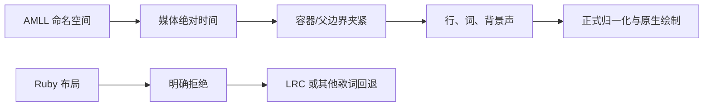

# 2026-11-02 AMLL TTML 命名空间时间配置报告

## 概述

本批让音枢原有有界 TTML 解析器识别 AMLL 歌词库明确声明的命名空间，并按该配置的媒体绝对时间语义解析歌词。确定性抽取的 12 个真实库样本中，11 个成功解析并与独立 Python oracle 对齐，另外 1 个因 ruby 注音布局被明确拒绝，避免把注音重复成演唱词。正式 App 的合成数据验证覆盖绝对时间跳转、标准 `seq` 回归和坏 TTML→LRC 回退；清洁未签名 IPA、T7 阶段副本及更新后的 iOS 27 workflow 已准备完成。

本批只扩大经过名称空间选择的 TTML 时间子集。它不宣称完整 TTML2、真实库歌曲音频播放、真实设备、VoiceOver 实际操作或签名安装已完成，也没有新增或改变 Sollin 逆向证据。

## 范围与边界

- 功能范围：`src/lyrics/ttml.ts`、歌词单元测试、正式 App 的 TTML UI 夹具、iOS 27 workflow 测试步骤。
- 输入识别：仅当根节点声明命名空间值 `http://www.example.com/ns/amll` 时启用 AMLL 配置；普通 TTML 继续使用原有的父容器相对时间。
- 时间语义：AMLL 配置中的 `begin`、`end` 使用媒体绝对毫秒；支持 `1.456`、`00:13.120`、`1:02.123` 和 `10s` 等库内观测形式。
- 容器语义：AMLL 配置明确拒绝 `timeContainer="seq"`，避免把绝对时间与标准顺序容器混合。标准 TTML 的基础 `par`、上一批实现的 `seq` 及嵌套容器保持不变。
- 声部边界：主歌词之外的 `x-bg` 可独立于主 `<p>` 时间存在，但仍受最近 `<div>`/`<body>` 边界夹紧；背景翻译与罗马音属于背景行。
- 文本边界：AMLL 合法零时长空白跨度只把相邻词连接，不生成零秒歌词；含 ruby 注解的布局明确拒绝，让归一化改选 LRC 或其他可用歌词。
- 安全预算：原有 2 MiB XML、深度 32、行/词/时间上限、DTD 与实体展开阻断不变。名称空间检测不放宽标准 TTML 或 XML 限制。
- 证据边界：真实 TTML 原文只存于 T7，不进入 Git；仓库只保留来源、路径、哈希、样本统计与脱敏结论。AMLL 仓库声明 CC0-1.0 只覆盖其项目声明，单首歌词的第三方版权未被独立确认。

## Evidence → Finding → Path

### Evidence

| ID | 观察 | 证据位置 |
| --- | --- | --- |
| E-001 | 固定来源为 `amll-dev/amll-ttml-db` 提交 `b411e06ec66e8d4a2668642f1e4254a654f244ec`；共 3,389 个 eligible `raw-lyrics/*.ttml`；选择 12 个均匀间隔排序路径，样本共 293,356 字节 | `build/logs/ttml-amll-source-manifest.json`；T7 `.../2026-11-02-amll-b411e06e/manifest.json` |
| E-002 | 基线运行 12/12 拒绝，错误均为 `TTML 时间格式不支持`；首个样本以 `00:17.292` 这类 `MM:SS.mmm` 时间开始 | `build/logs/ttml-amll-baseline-results.json` |
| E-003 | 5 个新增单元测试覆盖绝对时间、背景声独立边界与附属文本、零时长空白、标准 TTML 隔离、预算、混合容器和 ruby 回退 | `tests/lyrics.test.ts:100` 起；`build/logs/check-ttml-amll.log` |
| E-004 | 最终候选 12 个样本中 11 个支持；独立 oracle 核对 416 行、3,749 词、29 个背景词、4 个父边界夹紧词，支持样本的无序词降级为 0；第 12 个样本因 ruby 布局按预期拒绝 | `build/logs/ttml-amll-word-timing-oracle.json`、`build/logs/ttml-amll-candidate-results.json` |
| E-005 | 正式 App 三组 Release UI 运行均为 1 通过/0 失败/0 跳过，且 `exitCode=0`、`sourceUnchanged=true`；源码摘要和安装 bundle 摘要三组一致 | `build/logs/ttml-amll-ui-summary.json`、三份 `run-manifest.json` |
| E-006 | 8 张最终 PNG 均由 `verifyCaptureEvidence` 标为 ready，并已逐张人工核看；覆盖 10 秒、30 秒、舞台组、手动歌词和回退状态 | `build/ttml-amll-app-20261102-r2/`、`build/ttml-amll-seq-regression-20261102/`、`build/ttml-amll-fallback-regression-20261102/` |
| E-007 | 清洁 IPA 对应当前功能提交，manifest 无未提交改动；164 个 ZIP 条目无 CRC 错误，138 个 archive/IPA 文件逐字节一致；生产 AMLL 标记存在，测试/私人/签名材料标记不存在 | `build/logs/ttml-amll-archive-verification.json`；SHA-256 `47602c0977f8e55a0808c96810c839708a62e39c34ea371420d60b17e05307e6` |
| E-008 | 捕获来源到提交内容的映射确认三组 UI 捕获与产品提交 `ce0b19d44117c07ffa90ba2bece5d3ab426e7d30` 的产品源码一致 | `build/logs/ttml-amll-capture-to-commit.json`；SHA-256 `dc5d1b7b614f26879274816a09958486757f499e449cab29e87af7da582d8bdb` |

### Finding

| ID | 结论 | Evidence |
| --- | --- | --- |
| F-001 | AMLL 库的间隔时间格式不是普通 TTML 的相对时间输入；仅扩展通用时间正则会把区段或段落偏移重复累加，产生错误时间轴。名称空间隔离的绝对时间语义解决了基线 12/12 拒绝，并保留标准 TTML 行为 | E-001、E-002、E-003 |
| F-002 | 真实样本中的背景声时间可以越过主 `<p>`，但应停在最近的区段/歌曲边界；翻译和罗马音需要与背景行一起保留，不能归到主行 | E-003、E-004 |
| F-003 | ruby 注音不能作为额外歌词词进入现有绘制模型；明确拒绝并走 LRC 回退，比复制注音或静默丢字更安全 | E-003、E-004 |
| F-004 | 解析器兼容性和 App 交付是两层证据：真实库矩阵证明输入解析与独立 oracle 一致，合成 App 证明同一正式路径能够优选、绘制和定位，但两者合起来仍不等于真实库歌曲音轨的 App 验收 | E-004、E-005、E-006、E-008 |

### Path

| ID | 路径 | 证明范围 |
| --- | --- | --- |
| P-001 | T7 真实 TTML → 名称空间识别 → 绝对时间解析 → 父边界夹紧 → 主/背景行与词时间 → 独立 Python oracle 比较 | 11 个支持样本、1 个预期 ruby 拒绝；不包含音频或 UI |
| P-002 | 合成在线 TTML → 正式归一化/优选 → 舞台、经典和全部歌词 → 原生手势定位 → 暂停意图保持 | 正式 Release App 的 10 秒/30 秒和手势路径 |
| P-003 | 坏 TTML 或 ruby 布局 → 明确拒绝 → 富 LRC 回退 → 原跨平台歌词路径 | 正式 Release App 回退路径；与 AMLL/seq 夹具独立 |



## 基线与修正

基线使用与最终候选相同的 12 个固定文件。12 个文件的首组时间均为 AMLL 的缩短媒体时钟，旧解析器因此全部以 `TTML 时间格式不支持` 拒绝。修正没有简单接受新的字符串：只有精确 AMLL 命名空间才进入绝对时间分支；起止时间仍校验负数、倒置、跨父边界、未知单位、超上限和 `seq` 混合。

对照校验使用独立 Python `ElementTree` 遍历，不调用 TypeScript 解析器。Oracle 比较每行文本、起止、背景标记、翻译/罗马音归属与每个有序词的时间；源数据存在无序词时要求降级为无逐字时间。最终没有支持样本被静默降级。

## 真实库样本矩阵

完整哈希与 T7 路径保存于 `build/logs/ttml-amll-source-manifest.json`。下表哈希显示前 16 位：

| 样本 | SHA-256 前缀 | 结果 | 行 | 词 | 背景词 |
| --- | --- | --- | ---: | ---: | ---: |
| 01 | `9b794c83d8e572c1` | 支持 | 17 | 164 | 0 |
| 02 | `de85bdbb01bd949b` | 支持 | 14 | 50 | 0 |
| 03 | `a4562847171e5984` | 支持 | 63 | 354 | 20 |
| 04 | `983192b9634d9cb0` | 支持 | 27 | 374 | 0 |
| 05 | `9312fa848a6c899f` | 支持 | 46 | 583 | 0 |
| 06 | `43a1a2a771033a41` | 支持 | 40 | 383 | 0 |
| 07 | `018b8cd08e91e858` | 支持 | 22 | 300 | 0 |
| 08 | `7223caaf2f074303` | 支持 | 46 | 440 | 6 |
| 09 | `262f742fe3100727` | 支持 | 36 | 330 | 0 |
| 10 | `ba643a1dd788e70a` | 支持 | 51 | 382 | 3 |
| 11 | `6df38aa8284a583e` | 支持 | 54 | 389 | 0 |
| 12 | `1fa4f87ef22d5312` | 预期拒绝：ruby 注音布局 | n/a | n/a | n/a |

样本 08 的 4 个源词结束时间超过所在段落边界，解析后按父边界夹紧；独立 oracle 对这些区间给出相同结果。这个修正说明兼容真实输入时仍保留有界时间轴，没有把越界值直接泄漏给播放器。

## 正式 App 端到端

| 场景 | xcresult | 结果 | 关键覆盖 |
| --- | --- | --- | --- |
| AMLL 绝对时间 | `SourceUITests-1793593073123` | 1/0/0，183.795 秒 | 首段 10 秒；第二段绝对时间跳到 30 秒；舞台、经典与全部歌词单击保持、双击定位、长按设置；保持暂停 |
| 标准 `seq` 回归 | `SourceUITests-1793593393674` | 1/0/0，180.898 秒 | 原有顺序容器派生第二段仍定位到 30 秒；未沿用 AMLL 分支 |
| 坏 TTML→LRC | `SourceUITests-1793593638599` | 1/0/0，164.095 秒 | TTML 失败后原富 LRC、舞台和手动歌词来源保持；没有 AMLL/seq 夹具计数 |

三组使用同一源码摘要 `e1c94361812db67c609a61eea8316c68c74cf64b8dc930b8fccfebab75715592` 和同一安装 bundle 摘要 `33ca85b45c788c6a84cc7b11a20335e872dfa4934288c9bf60615999d169211c`。AMLL 计数为 `wy=2, tx=4, ttmlAmll=2`，seq 为 `wy=2, tx=4, ttmlSeq=2`，回退为 `wy=2, tx=4` 且无 TTML 专项计数。专项 runner 只有实际请求对应夹具时才通过，缓存歌词不能替代本轮证据。

## 测试、清洁包与存储

`npm run check` 为 **978/978、0 失败**，其中歌词专项新增 5 项。Node 语法、workflow YAML、Swift parse 与 `git diff --check` 通过；正式 UI 和归档再次完成 Release 编译。

清洁功能提交为 `ce0b19d44117c07ffa90ba2bece5d3ab426e7d30`。未签名 IPA：

- 字节数：**12,889,220**
- SHA-256：**`1e974ad0cd323eab2b32a7607873bdb1af5cad0411353944502f5581dd96fb19`**
- 架构/SDK/最低系统：arm64 / iphoneos26.2 / iOS 15.1；设备族 `[1,2]`
- ZIP：164 项、0 CRC 错误；138 个普通 archive/IPA 文件逐字节一致
- 签名：无签名、无 provisioning profile
- 内容：标准 seq 与 AMLL 生产标记、ruby 明确拒绝标记存在；fixture secret、私人域名、测试 adapter、测试名、私人路径/资源标记均不存在
- 既有构建路径元数据：2 处，已在验证 JSON 中列明，不声称全部路径已剥离

T7 真实挂载与写读探针通过。有效阶段为：

```text
/Volumes/T7 Touch/NexusMusic/BuildArchive/2026-11-02-ttml-amll-1e974ad0/
```

初始 `copy-receipt.json` 验证 213 个规范文件、41,985,390 字节，逐文件 SHA-256 一致，源文件继续保留。阶段验证后新增 `ttml-amll-capture-to-commit.json` 与清理回执，由 `supplemental-copy-receipt.json` 单独核验；该补充回执 SHA-256 为 `4a216a7f4a517ef6345fd97795131a424db0acdb3934ecdbcad823ab92885771`。两次错误命令产生的部分副本没有删除，已保存在 T7 `BuildArchive/Diagnostics/2026-11-02-ttml-amll-stage-copy-command-errors/` 并标记为无效。

清理回执记录无活动构建、内盘约 53.17 GiB、T7 约 605.97 GiB 可用；保留最新两个有效阶段 `1e974ad0` 与 `45decc82`、真实 TTML 语料、最终 xcresult/截图/摘要以及 reverse-skill 证据范围。本批零删除、零个人文件搬移。用户已授权全盘整理；后续若需释放空间，项目外用途不确定的个人内容先完整迁移到 T7 并逐文件核验，不盲删 `work/`、活动缓存、工具链或受保护证据。

## 复现

产品与单元测试：

```bash
cd /Users/ningli/WorkSpace/NexusMusic
npm run check
```

真实库 oracle，前提是 T7 样本和两份候选 JSON 仍按清单可取：

```bash
python3 build/verify-ttml-corpus-oracle.py
```

正式 App 三组回归：

```bash
source /Users/ningli/WorkSpace/Tools/env.sh
export NODE_OPTIONS= PYTHONPATH=
NEXUS_UI_RUN_DIR="build/ttml-amll-repro-$(date +%s)" \
  node scripts/test-ui.mjs NexusMusicUITests/SourceSettingsTests/testAMLLProfileLyrics
NEXUS_UI_RUN_DIR="build/ttml-seq-repro-$(date +%s)" \
  node scripts/test-ui.mjs NexusMusicUITests/SourceSettingsTests/testSequentialTTMLLyrics
NEXUS_UI_RUN_DIR="build/ttml-fallback-repro-$(date +%s)" \
  node scripts/test-ui.mjs NexusMusicUITests/SourceSettingsTests/testCrossPlatformLyrics
```

清洁 IPA 与阶段验证脚本为 `build/verify-ttml-amll-archive.py`、`build/archive-ttml-amll-stage.py`；它们依赖本机归档、工具链和真实 T7 路径，属于离线维护脚本，当前只在忽略的 `build/` 中保留。

## 云端与未完成边界

推送前远端 `main` 为 `a4b2596ce9c3ca3ffae558b46848330231f101fa`；2026-11-02 04:43Z 的 Actions 公开页嵌入数据为旧提交 `2abb0b6` 运行中、`3a310ab` 唯一 pending，即 1 运行/1 排队。本批功能提交尚未 push，因此不能把这两个旧运行当作本批结果，也未取消运行中任务或手动重派旧提交。正常 push 后的远端 SHA、pending 替换和后续终态在本报告末尾补录。

继续开放的真实缺口：

- 真实歌词库歌曲音轨在正式 App 中播放并渲染，而不只是解析器矩阵和合成 App；
- 实体 iPhone 的长歌曲滚动、时间精度、性能、功耗、后台和 VoiceOver 实际操作；
- ruby/注音绘制、完整 TTML2 样式布局、外部资源、其他时间基准及非 AMLL 私有扩展；
- Apple 签名、安装、覆盖升级和 iOS 27 GitHub Actions 本批终态；
- S4/J35–42 的其余动画、字体、来源、真实服务和设备验收。

本批没有新增 Sollin 原始采集、功能结论或 strict review 声明；不得用本报告替代项目既有 reverse-skill 门禁证据。
