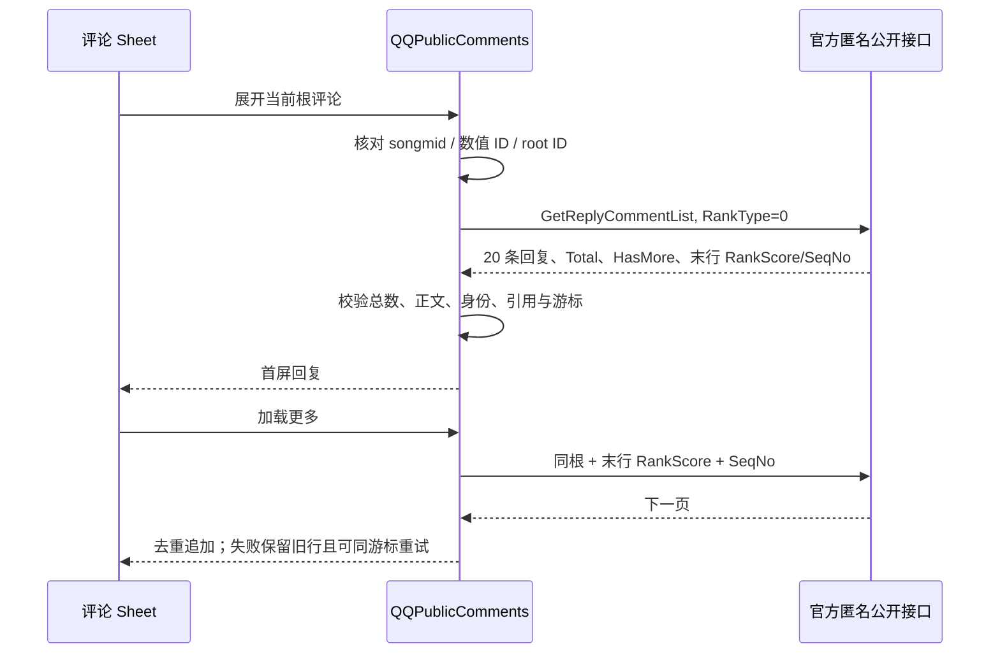

# QQ 音乐公开评论完整楼层展开回执

2026-11-02。本批为 F31 补齐 QQ 音乐原曲评论的匿名只读楼层增量：复用既有评论 Sheet，支持根评论展开、服务端 20 条分页、引用/作者身份展示、失败保留、同游标重试、空态和收起。合成与真实公开服务 Release UI 均通过；完整 F31、其他平台还剩的回复矩阵、账号写操作、iOS 27 云端、实体机、签名、弱网和连续动效仍未完成。

## 范围、来源与证据链

本批继续执行项目规定的 `reverse-skill` R2/mobile-reverse、既有离线 case、IPA/APK gate 和 strict review。离线 scope 为 [work/sollin-ipa/scope.md](../work/sollin-ipa/scope.md)，授权为本地自有样本、`network_profile: offline`；没有读取凭据、探测 Sollin 私有服务、修改目标 App 或扩展网络范围。

| 字段 | 本批值 |
| --- | --- |
| Evidence | `E-033`：评论 Sheet 固定头部、虚拟列表、热门/最新分区与刷新失效；不可变 artifact SHA-256 `e22d0159db751d0dec276b72d58798978b586a0422eb4e8977921099f657f9c5` |
| Finding | `F-032`：Sheet 头部与列表主体分离，分区/刷新/错误路径有静态调用关系；不证明后端、分页、头像、运行时几何或写操作 |
| Path | `P-032`：从歌曲评论入口到固定头部、列表主体、刷新/错误路径的已验证调用路径 |
| Timeline | [work/sollin-ipa/timeline.md](../work/sollin-ipa/timeline.md) 的 `2026-11-02T03:16:32+08:00` QQ reply reuse 事件 |
| Work item | `WI-011`，本批只增加 QQ 公开回复纵向能力，状态仍为进行中 |

`E-033 → F-032 → P-032` 只支持“复用哪个 Sheet 和交互骨架”。QQ 的现代公开回复请求、游标、字段和真实服务结果来自独立协议与本地 App 验收，不冒充新的 Sollin 证据。

固定公开协议来源：

- 官方 QQ 音乐网页 bundle：[common.chunk.5b378f933e2203b7da48.js](https://y.qq.com/ryqq/js/common.chunk.5b378f933e2203b7da48.js)，本机下载副本 SHA-256 `c6c5e7c652a9133779bec192a3fd79515c4ab5462e8d9d6f6d5e8cc75a470f5d`；提取的 module 488 SHA-256 `56e590012d633e18ef6be24746d03d3b0cc0b2312352505d35d28c9d41a28b9a`。
- 固定 Q-music 参考 `5db858f32695d10c5e9ef0f7037d586aef6a8c4b` 的 `src/utils/musicSdk/tx/comment.js`，SHA-256 `bd6bf6a57be8bb712fb131c12e1a8f53437de4797da949ec4d82f782ec7e604c`；根许可为 Apache-2.0，NOTICE 保留 Nshpiter、LX Music Mobile 及贡献者归属。

Q-music 固定文件仍覆盖旧普通评论路径、热门读取和引用预览，但不提供本批所需的现代完整楼层分页。实现只核对公开字段和 API 调用，没有复制其模块、表情码表、单例取消逻辑或 UI 代码。真实评论正文、昵称、头像 URL 和公开用户信息只留在本机忽略的 `build/` 证据中，未写入仓库。

## 实现

QQ 根评论读取切换到官方匿名 `u.y.qq.com/cgi-bin/musicu.fcg` 的 `music.globalComment.CommentRead/GetNewCommentList`。请求继续以原曲 songmid 解析并核对数值歌曲 ID，所有请求 `credentials: omit`；热门只在首屏读取，最新列表使用服务返回的 `SeqNo`、总数和 `TotalVer` 推进，每页固定 20 条。

完整回复使用同一模块的 `GetReplyCommentList`、`RankType: 0`，严格绑定原曲 MID、数值歌曲 ID 和根评论 ID。首个回复页的 `Total` 必须与列表根 `ReplyCnt` 一致；后续页若返回 `Total: 0`，保留首屏已验证总数，不把有时出现的零总数误写成空线程。下一页同时使用最终行的 `RankScore` 和 `SeqNo`：



边界与上限：

- 回复页固定 20 条，服务页码和 UI 偏移一致；无游标、非数字游标、超长页、越界 offset 和总数冲突直接拒绝。
- `canExpand` 只在当前会话确实观察到同一原曲和根评论时返回 true；换歌、非法 root token 或外部借用根评论 ID 不会发起楼层请求。
- 根缓存有界 2048 项，songmid→数值 ID 缓存有界 100 项，列表/回复游标各有界；这些缓存只存活于当前评论 reader/session。
- UI 回复最多显示 500 条；重复页或没有新增行时停止继续加载，刷新评论会清空该歌的线程状态。
- 回复作者头像、地区、日期、点赞和 `RepliedComments` 引用只取回复自身公开字段；缺失不借用根作者身份。
- 失败不清空已显示回复，重试请求失败前的同一游标；取消、收起、换歌、刷新和关闭会隔离迟到响应。
- 此能力是公开只读回复，不包含点赞、发评、删除、举报、账号态或平台写操作。

## 验证

本机最终检查：

| 检查 | 结果 | 证据 |
| --- | --- | --- |
| 完整业务/类型检查 | **948/948**，0 失败/0 跳过 | `npm run check`，2026-11-02 最终复跑 |
| TypeScript | 通过 | `npm run typecheck` |
| UI 脚本语法 | 通过 | `node --check scripts/test-ui.mjs` |
| diff 空白/错误标记 | 通过 | `git diff --check` |
| reverse-skill gate / strict review | IPA 与 APK prerequisite PASS；IPA `52E/17WI/109 events/43F/43P`，APK `3E/2WI/3 events/2F/2P`，均 0 错误/0 警告 | 四项 gate 命令，复用既有离线 case，无新增采集 |
| 合成 Release UI | **1/0/0**，测试执行 62.703 秒 | `build/SourceUITests-1793559850209.xcresult` |
| 真实匿名 QQ Release UI | **1/0/0**，测试执行 106.966 秒 | `build/SourceUITests-1793560098614.xcresult` |

测试环境为专用 `NexusMusic iPhone 15 Pro Max` iPhone 模拟器，iOS 26.3.1 / 23D8133，430×932pt、@3x，Release，Xcode 26.3 / 17C529，Node 24.14.0。模拟器不代表实体机。

合成场景从正常搜索/歌曲操作进入评论 Sheet，覆盖：

- 根评论显示 41 条回复，首屏加载回复作者、独立头像/地区、正文与目标引用。
- 第二页首次失败时保留首屏回复；重试复用 `RankScore=8`、`SeqNo=202` 并追加第三行。
- 收起回复后线程正文从界面移除；再次请求空回复时显示明确空态。
- 原最新评论第二页失败保留旧行，同游标重试追加并更新总数。
- 刷新失败保留已加载评论；最终真实空评论显示 0 条。
- 整个流程没有播放音频副作用。

合成 run manifest 的源码提交为 `75b1da6c82c8e957ff5f7de1eaebd5254e222e72`，dirty diff SHA-256 `3d05291d2ac49c4da0c0fb2da93bc48146df5439fbe8a4ba33ab66f2af366522`，source digest `0aa22f586eb6cece1b884523f7be55bb212e83d621e64ee45082d9403ee13460`，执行前后一致；安装 bundle digest `4af8fcd700c828aec0df4230707d228e69660fc5a4a8f71659330d32808c2be0`，xcresult Info SHA-256 `2c22f65d8058058aee98c4050631dd8ab07af9610daef44a79583c68f3891f47`。服务计数显示回复请求页 `[0,1,1,0]`，第二页一次失败和一次空态，重试游标均为 `8/202`。

真实匿名场景从正式搜索选择 QQ 音乐歌曲，进入公开评论，滚动取得正数回复控制，展开真实楼层，确认至少一条回复行和引用，再加载第二页根评论并确认最新列表追加。该轮观察总数 4757，真实回复计数、头像/身份、引用和分页均可见；没有记录评论正文到仓库，也没有启动播放。

真实侧 source digest 与 diff 和合成运行相同，`sourceUnchanged=true`；安装 bundle digest `9904dbd50faaca8749e4d9841584ede450ceb144c4fecf54329bb98fe5de3d7c`，xcresult Info SHA-256 `939ad30b6633fa87b032efb94149ff426eede1e79d34a883e8256423b1d7eeac`。

| 截图组 | 数量 | 来源与 SHA-256 |
| --- | ---: | --- |
| `build/ui-qq-comment-replies-synthetic-1793559850209/` | 6 PNG | 每张 provenance ready 并亲看；索引 `index.json` 记录逐图 SHA-256 |
| `build/ui-qq-comment-replies-live-1793560098614/` | 4 PNG | 每张 provenance ready 并亲看；含真实公开用户内容，只留本机忽略目录 |

精确场景、几何和截图哈希见[本批 UI 规格](ui-spec/qq-comment-replies-2026-11-02.md)。

## 失败与修正

两次合成失败均为同一真实夹具根因，不是 QQ 适配器缺陷：

- `build/SourceUITests-1793559104280.xcresult`：1 failure；`build/failure-evidence/SourceUITests-1793559104280/` 保留原始附件。
- `build/SourceUITests-1793559618104.xcresult`：1 failure；`build/failure-evidence/SourceUITests-1793559618104/` 保留原始附件。

真实首屏最后一行返回 `RankScore=8`、`SeqNo=202`，适配器按服务响应发送 `8/202`；夹具却错误期待 `9/201`。服务计数证明失败后的重试仍复用同一 `8/202`，说明失败保留和同游标重试正常。测试夹具改为平台实际返回的 `8/202` 后通过，产品没有为迎合错误夹具而改变游标。

UI 测试辅助函数同时加固：当控件只从 page-sheet 边缘露出一部分时，即使 `isHittable` 为真也会继续滚动，直到整个目标位于安全区域。此前局部可见控件可能把点击解释成系统 Sheet 下滑；最终六张合成和四张真实截图是在该修正后取得。

## 未验范围

- 本轮只关闭 QQ 公开评论只读回复增量，不关闭完整 F31、其他平台完整楼层或账号评论能力。
- iOS 27 GitHub Actions、真实 iPhone、签名和 provisioning、锁屏/后台、真实弱网/限流、超长楼层压力、连续手势与转场仍待独立验收。
- 本机模拟器仍缺部分 emoji/特殊字形；不声明可视 emoji 字形正确。
- 不声明与 Sollin 像素或动效一致。共享 Sheet 的结构证据通过，但视觉完成度只按本批正常入口、可达、失败/空态和分页状态验收。
- 合成响应、编译成功、模拟器运行和未签名归档都不能替代实体机真实播放或公开服务的全部图片/字段可用性。

## 复现

```bash
source scripts/environment.sh
unset NODE_OPTIONS PYTHONPATH
npm run check
node --check scripts/test-ui.mjs
git diff --check
node scripts/sollin-reverse-gate.mjs ipa
node scripts/sollin-reverse-gate.mjs apk
node scripts/sollin-reverse-gate.mjs ipa --review
node scripts/sollin-reverse-gate.mjs apk --review
node scripts/test-ui.mjs NexusMusicUITests/SourceSettingsTests/testPublicQQComments
node scripts/test-ui.mjs NexusMusicUITests/SourceSettingsTests/testLiveQQPublicComments
```

正式证据必须使用上文精确 xcresult，不使用 `latest` 覆盖旧结果。仓库不回写真实公开用户内容、匿名请求原始响应、账号材料或播放 URL。

## 文档自检

- 本文按 `docs-generator` 生成，选用 `flavor = null` 的逆向/技术交付结构，不套 malware/APT 章节。
- Scope、Evidence、Finding、Path、Timeline、复现与未验边界均已给出。
- 公开协议来源、文件哈希、Q-music 许可和独立实现边界已记录。
- 没有把证据门禁、合成夹具、模拟器或构建成功改写成完整目标完成。
