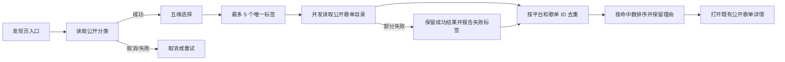

# 定制风格化推荐与归档回执（2026-11-03）

> 分析日期：2026-11-03
> 执行者：Codex
> 工具链：固定离线 IPA、reverse-skill R2/mobile-reverse、TypeScript/Node、Xcode 26.3、iOS Simulator 26.3.1
> 报告 flavor：`null`（普通离线逆向与产品对齐，不套 malware/APT 模板）

## 结论

音枢已在发现页加入“定制风格化推荐”正式入口。用户可在曲风、语种、情感、主题和场景五个维度中选择最多五个唯一标签，随后只聚合所选平台的公开歌单目录。结果按平台和歌单 ID 去重，命中标签数优先，并保留全部命中理由；用户可以取消分类读取或生成、重试、看到空结果或部分失败，并打开既有公开歌单详情。

本批实现以固定 Sollin iOS 2.0.0 build 60 的离线静态证据 `E-056 → F-047 → P-047 → WI-021` 为边界。证据只支持五维、五标签上限和选择持久化的可见产品结构，不证明 Sollin 的私有生成协议、账号画像、服务端排序或运行时结果。

产品提交 `fc39a76bfc2c32f83d1a2371121b86299933c2c5` 已正常推送，远端 `main` 与本地一致。清洁未签名 IPA、正式 Release UI、strict review 和本地检查均已通过；iOS 27 云端终态、实体 iPhone、真实账号个性化、VoiceOver、动态字号、弱网、连续动效和签名安装仍保持开放。

## 范围、授权与来源

- 离线案例：`work/sollin-ipa`，scope 为 `auth=user_supplied_local_sample`、`in_scope=fixed_offline_ipa_static_analysis`、`network_profile=offline`。Scope 摘要见[本地 scope](../work/sollin-ipa/scope.md)与[工作流固定说明](REVERSE_SKILL_WORKFLOW.md)。
- 固定样本 SHA-256：`c2ee2deba236ef1b9e097e1d8cdc0b816137aa57cf85d4c8e2811dae9924bc07`。
- 只读取离线 object pool、dispatch 和 source skeleton；没有启动目标进程、访问 Sollin 私有服务、读取账号数据或发送凭据。
- Android 截图只用于检查五维和层级，不证明 iOS 运行时等价。音枢结果来自网易云公开分类与公开歌单目录，不冒充 Sollin 私有推荐或真实网易账号个性化。

## 实现

- `src/domain/styleRecommendation.ts` 将平台公开分类归入五维，限制最多五个唯一标签，按平台与歌单 ID 去重，按命中数排序并保留全部匹配理由。
- `src/providers/discovery.ts` 仅读取网易云公开分类和公开歌单目录。单标签读取失败不会丢弃其他成功结果；取消会中止在途请求并隔离迟到代次。
- `src/ui/StyleRecommendationSheet.tsx` 提供分类加载、取消、重试、维度切换、选择/移除/清空、第 6 个标签禁用、生成/取消、空结果、全失败、部分失败和结果详情入口。
- `src/ui/Discovery.tsx` 使用正式发现页入口接通 Sheet。公开歌单只在用户点击后进入既有详情；推荐结果不成为第二权威队列，也不持久化成新的远端歌单。

## 本地验证

- `npm run check`：990/990 通过。
- `node --check scripts/test-ui.mjs`、Swift 解析、工作流 YAML 与 `git diff --check` 通过。
- 完整 `npm run test:native` 通过。
- `npm run ios:build`：`BUILD SUCCEEDED`。
- `npm run ios:archive`：`ARCHIVE SUCCEEDED`。
- 正式 Release `SourceUITests-1793642239978` 的 `testStyleRecommendation`：1 passed / 0 failed / 0 skipped，95.008 秒；manifest `exitCode=0`、`sourceUnchanged=true`。
- 9 张 1290×2796 PNG 已导出并逐张人工查看，覆盖入口、分类取消/重试、五维、0/5 至 5/5、第 6 个禁用、生成取消、空结果、失败、部分失败去重排序、命中理由和打开公开歌单详情。

## Evidence → Finding → Path

| 类型 | ID | 字段摘要 |
|---|---|---|
| Evidence | `E-056` | `source_type=file`；`source_ref=evidence/stylized-recommendation-evidence-20261103.json`；`content_hash=7561b530227eb6740f7931d244f40ef72d20ef7bd263b53d5960d1fc27551f55`；`linked_workitem=WI-021` |
| Finding | `F-047` | `severity=info`；`category=design`；`status=candidate`；`confidence=high`；`evidence_ids=[E-056]`；`location=work/sollin-ipa/report/stylized-recommendation.md` |
| Path | `P-047` | `path_type=callflow`；起点为发现页入口；终点为选择最多五个公开标签、获得确定性的去重歌单、打开既有详情并安全取消/重试 |
| Work item | `WI-021` | 固定样本的五维、五标签和公开目录原创聚合 |



复核命令：

```bash
source scripts/environment.sh
node scripts/sollin-reverse-gate.mjs ipa --review
shasum -a 256 work/sollin-ipa/evidence/stylized-recommendation-evidence-20261103.json
```

`ipa --review` 为 PASS：56 Evidence、21 WorkItems、119 timeline events、47 Findings、47 Paths，0 errors、0 warnings。本批没有新增采集或私有探测。

## 清洁归档与隐私排除

manifest 对应产品提交、`dirty:false`、`workingTreeChanges:[]`、`signed:false`。归档为 arm64、`iphoneos26.2`、最低 iOS 15.1、设备族 `[1,2]`，bundle 为 `com.nexusmusic.app`。

- IPA：17,825,526 字节，SHA-256 `67bc068bebf51bd09d8823c45cf6fa79a0a76591fbcaecb4893a6732cd1bc1d2`。
- ZIP：178 个条目，CRC 全部通过；151 个普通文件与 archive 路径和逐文件字节一致。
- 无顶层或嵌套 `_CodeSignature`、描述文件、签名材料、测试夹具或私人资源标记。
- 生产 `main.jsbundle` 存在 `discovery-style-recommendation` 与“定制风格化推荐”标记。
- 归档核验回执 SHA-256：`455e02faca7f434c07835e90136a6e672fff2bb029dd37f8ecceaa9e679d69a5`。
- manifest SHA-256：`36d7c50764b93812f931a6d698bbf142356fa63f8c0008ad36cef2067461160b`。

扫描曾命中测试源码中的故意夹具字符串 `fixture-secret`、`private.invalid` 等，它们均属于既有脱敏测试，不进入生产 IPA。针对本批生产文件的私钥、访问令牌和真实凭据模式扫描通过。

## 云端与后续

产品提交已正常推送并实核 `origin/main=fc39a76bfc2c32f83d1a2371121b86299933c2c5`。推送后 GitHub Actions 队列为 1 运行 / 1 排队：`41455717983` 继续运行，`41498672211`/`fc39a76` 为唯一 pending；旧 `41489113091` pending 由 `queue: single` 自动取消，没有手动取消运行中任务或重派旧版本。`41498672211` 的终态尚未取得。

仍待验证：

- Sollin 私有推荐协议、账号画像和服务器排序模型。
- 真实网易账号个性化，以及真实公开目录弱网、限流和长期稳定性。
- 实体 iPhone、VoiceOver 实际手势、动态字号、小屏和性能。
- Sheet 连续拖动、转场和结果更新动效的逐帧等价。
- 签名、安装、续签和 iOS 27 云端终态。

本批只关闭公开分类风格化推荐的功能与静态界面增量，不关闭完整 Sollin 发现能力、F/J 或项目。

## T7 阶段归档

T7 独立阶段目录为 `/Volumes/T7 Touch/NexusMusic/BuildArchive/2026-11-03-style-recommendation-fc39a76/`。目录保存未签名 IPA、archive、XCResult、9 张 PNG 与索引、运行/strict 日志、离线 scope/timeline/workitems/E-056/Finding-Path 摘要、产品提交补丁、当前文档补丁和文档快照。

复制后按普通源文件逐项比较 SHA-256；本阶段纳入比较的有效源文件为 157 份，路径缺失与哈希差异均为 0。源证据继续保留，`deleted=0`、`movedUserFiles=0`；阶段开始和收尾均未发现活动 Xcode/archive/Metro/Gradle 构建。`SHA256SUMS` 与 transfer receipt 在 T7 原地生成并复核，exFAT `._*` 元数据不计入有效 payload。
