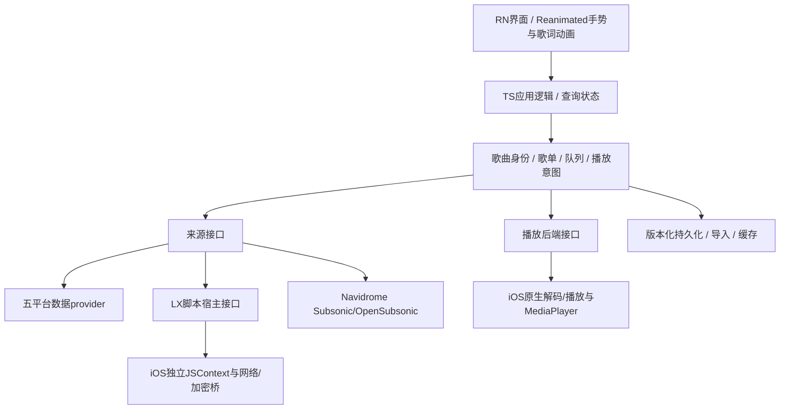

# 技术框架决策

日期：2026-10-14。状态：推荐 RN 路线，框架版本/播放器未锁定；等待环境和纵向验证，不声称完成性能评测。

## 决策问题

iOS 先实现，未来可能 Android；在线 LX 音源 + Navidrome；无汽水、ECARX、CarPlay和本地音乐管理；已有三个 RN 参考。应选择既满足 iOS 体验，又能控制新建成本和未来重复工作的技术。

UI、音频、脚本执行和系统扩展是不同层，不应把 UI 框架选择与音质或后台保活直接等同。

## 三条路线

| 维度 | SwiftUI + 必要 UIKit | Flutter | React Native 新架构 |
| --- | --- | --- | --- |
| iOS 系统交互 | 接入直接，原生 API 同语言边界较少 | 通过插件/原生模块 | 通过原生模块/组件 |
| 后续 Android | iOS UI通常重做；可共享协议/测试/服务设计 | 业务和主要UI可共享，平台能力仍适配 | TS业务和主要UI可共享，平台能力仍适配 |
| 当前参考复用 | 算法/协议可翻译，RN UI/状态不能直接用 | 需重写为 Dart，原生模块可适配 | TS/JS provider、模型、交互和原生接入更易复用 |
| 歌词/手势/动效 | 可用 SwiftUI/UIKit/Canvas/Metal，仍需正确实现与测量 | 自绘和动画工具完整，仍有布局/耗时任务/平台插件风险 | UI worklet/原生组件可避免每帧React更新，仍需隔离JS重活 |
| LX 脚本 | 原生 JS 引擎 + 网络/加密桥仍要做 | 独立 JS 引擎/宿主 + Dart/原生接口仍要做 | 独立 JSContext/原生宿主，TS协议资产可复用 |
| 后台音频 | AVFoundation/MediaPlayer | just_audio/audio_service等或定制原生 | RNTP/Expo Audio等或定制原生 |
| 当前项目重建成本 | 大部分应用UI和业务重写 | 大部分应用UI和业务重写 | 复用价值最高，但不是无条件复制参考工程 |
| 旧 Intel Mac约束 | 依赖Xcode | 同样依赖Xcode | 同样依赖Xcode |

没有做真实同功能性能/能耗对照，不能给出“框架A必然120Hz，B必然卡顿”等排名。

## 对外部框架建议的纠偏

1. **原生有直接的系统集成优势，但不自动获得最低功耗或稳定120Hz。** 解码、网络、布局、模糊、动画、可见区域和刷新频率都影响性能。必须在 Release 真机测量。
2. **UI框架/跨语言调用本身不导致音频有损。** 正常播放器在原生解码和音频线程输出，不把PCM逐样本通过UI桥。音质取决于源文件、解码、重采样、混音、系统路由与硬件。
3. **Flutter的Impeller并非“彻底解决所有Jank”。** 它离线处理shader/pipeline等渲染工作，不能消除Dart耗时任务、布局、纹理、插件或原生主线程阻塞。[官方说明](https://docs.flutter.dev/perf/impeller)
4. **不能只用旧RN异步bridge评价新架构。** 新架构使用JSI；Reanimated worklet可以在UI线程运行。歌词不应逐毫秒从JS发整份状态，而应原生时间采样、时钟插值、UI局部渲染。[RN新架构](https://reactnative.dev/architecture/landing-page)、[Reanimated线程模型](https://docs.swmansion.com/react-native-reanimated/docs/fundamentals/glossary/)
5. **Widget/Live Activity使用原生扩展，不要求整个主应用原生重写。** ActivityKit/WidgetKit/SwiftUI负责对应展示，RN或Flutter主应用可以桥接。音枢尚未确定这些为首期功能，不用它们强迫框架决策。[Apple文档](https://developer.apple.com/documentation/activitykit/displaying-live-data-with-live-activities)
6. **Expo不是第四种UI框架，也不等于只能用Expo Go。** Expo是RN工具/模块生态，可编写Swift/Kotlin原生模块；音源宿主等自定义能力需开发构建/原生工程，不能只在Expo Go验证。[Expo Modules](https://docs.expo.dev/modules/overview/)
7. **只因未来“可能Android”不足以证明Flutter必选。** 本项目有大量JS音源与RN参考资产，重写为Dart的成本应计入；若未来团队以Dart为主、从零建强自绘UI，Flutter仍是合理替代。

## 推荐架构

React Native 新架构 + TypeScript；可使用Expo Modules及必要工具。iOS音频与系统媒体接入为原生层，LX音源为独立受控脚本宿主，Navidrome走公开协议。

未来Android只替换平台适配层并验收后台服务、媒体控制、音源引擎等。不能承诺全量UI/业务零改动，也不为未确定的Android需求提前写第二套原生实现。

状态原则：一个权威业务队列，一个播放意图，原生回调携带媒体身份与操作代次；暂停后的迟到URL不允许自动播放，旧请求不允许覆盖新选择。

性能原则：PCM在原生音频链处理；JS业务线程不执行解码/高频FFT；歌词按有效行/字时间插值，worklet或原生绘制，避免每帧重建列表。原生能力与UI互通不是禁止通信，而是控制粒度与频率。

存储原则：音乐库与歌单持久化、缓存索引、账户凭据分层；应用元数据可采用SQLite/版本化仓储，秘密放Keychain。具体库锁定前先验证旧工具链、原生模块和迁移需求。不并存Redux/Zustand/另一套业务状态作为重复权威。

## 参考项目的使用方法

| 项目 | 拟复用/借鉴 | 已知不能照搬 |
| --- | --- | --- |
| CyMusic | 原生JSC、播放器边界、文件/缓存、手机组织 | LX musicUrl的tx固定字段、三档回退；RNTP v5独立许可；原生补丁和高版本工具链 |
| 悦音 | 五平台元数据、发现/搜索/榜单、歌单转换、主题 | new Function探测不是完整LX宿主；逐字歌词模型不足；自动cache不是长期离线库 |
| Q iOS分支 | LX类型/字段、音频系统边界、FLAC解码经验 | RN0.73旧依赖、庞大AppDelegate、双播放路径和本地native FLAC限制 |

不复制参考项目个人账号、品牌、服务器或私人脚本配置。只选择必要模块，保留来源/许可和确定性验证。

## 版本与工程管理

- 候选A：验证已研究CyMusic提交的依赖图：Expo57.0.21 / RN0.86.3 / RNTP5.9.2。它要求的工具链可能超出用户本机能力，不能未经验证直接作为最终版本。
- 候选B：若本机工具链约束显著，验证受支持的较低RN/Expo组合，补入独立脚本宿主；不能靠任意降级或删除原生能力冒充兼容。
- 候选C：保留现代依赖，使用兼容远程Mac构建；本地编辑，IPA真机测试，接受调试限制。
- 选择结果须写明Node、包管理器、锁文件、Expo/RN、Reanimated、播放器、Pods、macOS、Xcode、最低iOS和原生补丁。
- 不同时升级框架、替换播放器、重写脚本宿主和迁移存储。先建立已知可构建基线。
- 在“维护ios/工程”与“config plugin可重复生成”之间明确选择。含手工原生模块的工程不能无记录执行clean prebuild覆盖。

播放器暂以候选底座验证为主，不在文档阶段同时承诺RNTP和Expo Audio。RNTP v5个人用途许可独立；若不匹配用途或表现不达标，再定向替换。[许可原文](https://github.com/gyc-12/Cymusic/blob/bf0d4694acb52973bcd594d31b3c61f655e166cb/third-party-licenses/rntp-player-5.9.2.txt)

## 替代方案重新考虑条件

- 若明确永远只做iOS且原生定制优先于现有资产复用，重新评估SwiftUI/UIKit。
- 若未来Android变为同步首发、团队以Dart为主且愿意重写providers/宿主桥，重新评估Flutter。
- 若RN在目标真机的可重复基准中无法满足歌词/手势/后台要求，先定位具体瓶颈；不能仅因Debug卡顿就重写全项目。

## 开始实施的候选基线

用户已授权开始实施，采用 Expo54 / RN0.81 候选验证本机构建；官方版本表最低 Xcode16.1，仍须实际构建。选择维护并提交 ios/ 工程，初建只生成一次，不执行覆盖性 clean prebuild。详细版本和验收见 TASK_PLAN.md、package-lock.json 与后续构建记录。播放器仍需独立验证后锁定，未直接复制参考依赖图。

## 功能级选型要求

用户补充了wtfdelphia LX和自有Wayferar-Music，并要求连同悦音、Q-1515、CyMusic在后续每项功能实现前详细比较实现/维护/Android移植后再采纳。见 [REFERENCE_COMPARISON.md](REFERENCE_COMPARISON.md)。不以当前候选工程基线替代生产后端和宿主的功能级决策。
