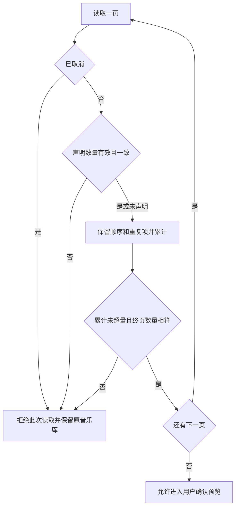

# 0050 完整歌单读取的数量一致性

2026-10-18，A08。原生reverse-skill路由ipa-playlist-completeness为R2/mobile-reverse；既有离线scope仅case-guard，采纳前strict review22E/21F/21P、8WI/40事件零错误/警告。E022→F021→P021仅证实详情数量helper与独立loadAll边界，不能证明Sollin完整分页、计数一致性或取消协议。本批修音枢原创实现，不增加provider接口或参考默认值。

## 五参考比较

本批重新核对五个固定HEAD及以下实现。完整来源与资源/原生许可边界见[参考比较](../REFERENCE_COMPARISON.md)。

| 参考与固定提交 | 实现比较 | 维护、Android及许可 |
| --- | --- | --- |
| 悦音d6f1af7f911e84babce56cd07297b44cfe46eed9 | src/store/reducers/playlist.ts:25–55仅本地hydrate/增删改，不证明服务端完整性；保留音枢独立provider与原子创建 | Expo54相近，根MIT与资源独立；TS层不证明Android网络取消 |
| Q-1515 547ccfe63ea5b8f734e6842c3b4c3b1225bbf39a | src/core/songlist.ts:195–223按total/limit递归拼接，末尾deduplicationList；详情listAction.ts:55完整读取后创建歌单。只参考分离预览/完整读取，保留音枢重复项与数量校验 | RN0.73/fork维护成本，Apache2/第三方及原生独立，Android缓存/取消另验 |
| wtfdelphia6624ab58cbd2f5bda52ab8006912d3c60dc1f847 | 同路径195–223有相同递归/缓存/去重；未提供本批跨页总数变化校验依据，不复制递归或全局缓存 | 旧RN/fork，Apache2与原生独立；不移植Android服务 |
| CyMusic bf0d4694acb52973bcd594d31b3c61f655e166cb | src/store/library.tsx:95–135从固定榜单获取后本地slice分页；不能作为完整公开歌单或远端终页证明 | Expo57/RNTP5超基线，Apache2与原生独立；不引入新依赖 |
| 自有Wayferar8e47cdc701cdbb772577b2bf7abb699e285b0fa6 | docs/CORE_CLEANUP_REPORT.md:15–29记录发现/歌单分页保留与smali核验；文档不证明iOS完整计数/取消语义 | Android/车机/smali权威与Java参考区分，自有改动/第三方许可分别保留 |

## 原创缺口与方案

原complete只依赖hasMore停止，终页短于或超过平台声明总数时可返回“完整”结果；跨页total变化或后续缺失时未保留已知总数，最后await返回后也未重新检查abort。5项独立失败基线见本机build/logs/discovery-completeness-baseline.log，另两项控制测试证明未知总数和原始重复项继续有效。

每次detail返回后先检查取消；有效total必须为非负安全整数，已知总数跨页保持一致、缺失则沿用上一值。累计条目不得超过总数，终页必须恰好等于已知总数；未知总数沿既有hasMore/分页推进/200页与20000首上限。失败只拒绝此次完整读取，页面已加载数据及原音乐库保留，用户可重新读取；不去重、不更改播放队列。

本批359业务/类型检查通过。App1792270600285完整发现专项125.372秒通过、零失败/跳过，截断错误不弹创建确认、入口可重试且恢复完整结果后预览2首；原取消/收藏/重复项/两种Sheet及清理均保留。已亲看2/3计数、错误提示与两首已加载歌曲同时保留截图；本机合成请求16次（网易11、酷我列表2、详情3），没有真实平台服务或音频请求。本地清洁归档、云端iOS27、真实服务/签名/手机另验。

图仅表示音枢原创逻辑；上限和未推进分页拒绝继续沿既有实现。未声明总数时不能证明远端自身完整性，只能依赖返回分页契约与推进检查。
